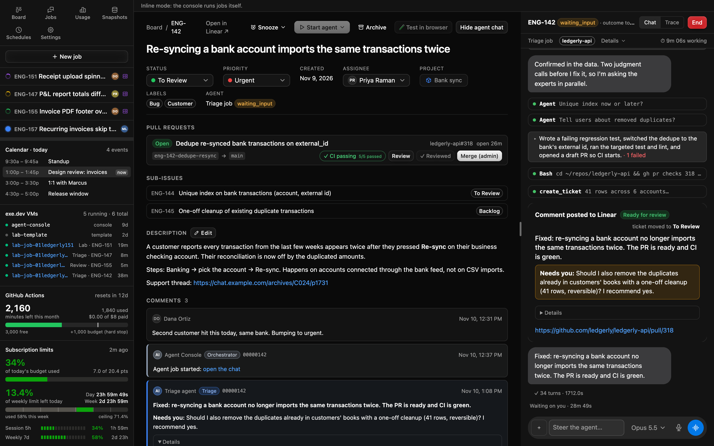
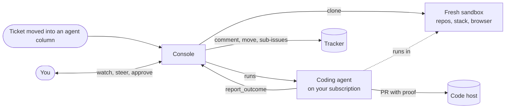
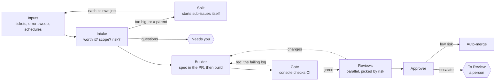

# Agent Console: a spec, not a product

This is the design for an **agent console**: a small internal app that takes tickets from your tracker,
runs a coding agent on each one in its own throwaway sandbox, shows every run as a live chat you can steer, and
does all the ticket bookkeeping itself. I built one for my team. This repo has the **why, the how and the prompts**
so you can build your own version with your own agents. It has no code.

> [!NOTE]
> The screenshots throughout these docs are from **my own build** of this spec. They show one way the design can
> look in practice, not a product you can install. Yours will look different, because it should fit your process.
> All data in them is fictional.

Why no code? Mine is tied to my company's tracker, cloud, repos and domain, and untangling that would leave you a
worse starting point than a clear spec. A spec also suits the thesis below: the console is worth building because
it encodes **your** process. Copy the ideas and replace the parts that don't fit.

## Where the pipeline is heading

Version 2 is one job per ticket: intake, a builder, a gate the console checks, parallel reviewers that send work back
to the same builder, and an approver that merges low-risk work on its own. It borrows the gate, reviewers and approver
from the software factory [ZazenCodes](https://www.youtube.com/@ZazenCodes) builds, which helped me hone and guide my
own process. [Doc 13](docs/13-pipeline-v2.md) compares it with today's version.

## Read in this order

| # | Doc | What it answers |
|---|---|---|
| 1 | [Why build your own](docs/01-why.md) | The philosophy: codify your process, own the robot, let code do the books |
| 2 | [Architecture](docs/02-architecture.md) | The pieces, the interfaces between them, a ticket's path end to end |
| 3 | [Board and routing](docs/03-board-and-routing.md) | Columns, the triage decision, outcomes, how the console writes to the tracker |
| 4 | [Jobs](docs/04-jobs.md) | The job record, state machine, concurrency cap, restart recovery, parking |
| 5 | [Sandboxes](docs/05-sandboxes.md) | A fresh VM per job: template, clone, delete safety, running the agent remotely, secrets |
| 6 | [Agent tools, prompts and experts](docs/06-agent-tools-and-prompts.md) | The console's tool contract, how prompts compose, "experts before people" |
| 7 | [Epics and umbrellas](docs/07-epics-and-umbrellas.md) | Big features as ordered children on a feature branch; parents that sort their sub-issues |
| 8 | [The human side](docs/08-humans.md) | The UI, steering, writing for a tired person, more than one person |
| 9 | [Scheduled work](docs/09-scheduled-work.md) | Sweeper, error-tracker sweep, auto review, resolutions, policy watch, backups |
| 10 | [Security and billing](docs/10-security-and-billing.md) | Threat model, guardrails, subscription billing and the fallback |
| 11 | [Build order](docs/11-build-order.md) | Phases, go/no-go checks, and what I'd do differently |
| 12 | [Self-improvement](docs/12-self-improvement.md) | Grading every run, an improver that proposes prompt edits, and scores charted against prompt versions |
| 13 | [The pipeline, version 2](docs/13-pipeline-v2.md) | Today's pipeline beside a simpler one: one job per ticket, a gate, parallel reviewers, an approver that can merge |

Then: [`prompts/`](prompts/) holds the agent prompts as templates, and
[`BUILD-WITH-YOUR-AGENT.md`](BUILD-WITH-YOUR-AGENT.md) is a prompt you can hand to your own coding agent to start
building.

## Glossary

The docs use these provider-neutral words. "What I used" notes say what filled each role for me.

| Term | Meaning | What I used |
|---|---|---|
| **Console** | The app this repo describes: server, database, UI, scheduler | TypeScript, Hono, SQLite, React |
| **Tracker** | Where tickets live; its board columns drive the agents | Linear |
| **Code host** | Repos, PRs, CI | GitHub + GitHub Actions |
| **Relay** | Turns tracker webhooks into one signed call to the console | A tiny existing webhook service; the console can receive webhooks directly |
| **Agent runtime** | The coding agent the console drives | Claude Code via the Claude Agent SDK |
| **Sandbox** | A throwaway VM a single job runs in | exe.dev VMs |
| **Template** | The VM every sandbox is cloned from: repos, toolchain, app stack, seed data, headless Chrome | A long-lived exe.dev VM, rebuilt by script |
| **Transport** | How the console starts the agent in a sandbox | A generated wrapper that runs `claude` over ssh |
| **Job** | One agent run on one ticket in one sandbox, with its full transcript | A row plus an append-only event log |
| **Job kind** | Which prompt and rules a job runs with: triage, lab, review, test, umbrella, error-sweep | `prompts/*.md` |
| **Outcome** | The single structured result an agent reports; the console turns it into tracker writes | `report_outcome` tool |
| **Expert** | A read-only subagent that makes a judgment call so the job doesn't wait on a person | `prompts/experts/*.md` |
| **Sweeper** | The console's periodic tick: stuck tickets, idle jobs, time caps, epic advancement | Every 5 minutes |
| **Owner** | The person a job acts for: whose subscription it bills and whose name it writes under | Whoever moved the ticket |

## What this is not

- **Not an agent framework.** The agent runtime already does the agent loop, tools, skills and subagents. The
  console is the factory floor around it: intake, isolation, supervision, bookkeeping.
- **Not a hosted product.** It's built for one team's process, and that's the point.
- **Not finished.** It's about a week of building and still changes daily. The specs describe what has held up.

## A note on billing

My console drives the agent CLI on a Claude **subscription** rather than an API key. Read
[Security and billing](docs/10-security-and-billing.md) before copying that. Provider terms change, and you need to
check the current ones yourself. The design includes a weekly policy watch and a one-switch fallback for that reason.

## Credits

Thanks to [ZazenCodes](https://www.youtube.com/@ZazenCodes), whose software factory videos helped me hone and guide my own process.

## License

[CC BY 4.0](LICENSE). Use it, adapt it, and credit the source.
