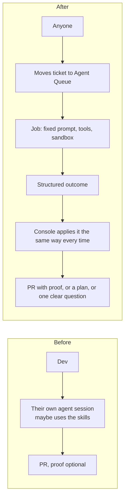

# 1. Why build your own

## The problem it solves

Agents make one engineer fast. A team needs something different. You can write skills for your workflow and ask
everyone to use them, but you can't tell whether a given session did. The shipping process (investigate, reproduce,
write a failing test, fix, verify independently, open a PR with proof) lives in a few heads and a few prompt files.
Any session might follow it or might not.

What I had before was a few hand-built, long-lived agent boxes with no browser, one shared database leaking
between sessions, and no idle timeout. One session held a box for 54 days. Every run was a little different.

The console fixes that by **making the process the only path**. A ticket enters through one door. The job's
prompt, tools and sandbox are fixed by its kind. The result has to come back as a structured outcome, and the
console's own code (not the agent) decides what happens next in the tracker. Steps can't be skipped because the
steps are the system.

## Own the robot

A friend I demoed this to put it in terms of the assembly line. When car making automated, the biggest gains
didn't go to the companies selling general-purpose robots. They went to the manufacturers who built machines for
**their own line**, because the line was their advantage. Agent tooling will likely go the same way: every
serious team ends up with an internal agent platform shaped like its process.

Off-the-shelf products exist and some are good. They're built for everyone's process, so you end up bending your
process to fit them. The console is small enough (a few days to a useful version) that building it is cheap
compared with the leverage, and you can change it the same afternoon your process changes.

That's also why this repo is specs and prompts, not code. My code is shaped like my line. Yours should be shaped like yours.

## Principles that held up

These came out of building and running it. Each doc points back to them.

1. **One front door.** Every ticket goes to Triage first, and Triage routes it. Nobody chooses the
   "right agent" by hand.
2. **Code does the bookkeeping, agents do the judgment.** Agents never write to the tracker directly for their own
   ticket. They report an outcome and the console moves the ticket, comments, creates sub-issues and sequences
   epics. Code does that deterministically, so two jobs finishing at once can't confuse it.
3. **A fresh sandbox per job.** No shared databases, ports or leftover state, and agents can't reach the
   console or its secrets. Cleanup is one rule: job ends, VM deleted.
4. **A fresh context per job.** Every agent starts clean, with exactly the context the console gives it: the
   ticket, its comments and the prompt for its kind. Continuity lives in the tracker and in branches, not in a long-lived
   session.
5. **Proof, not claims.** "Done" means a failing test that now passes, CI green on the pushed SHA, and an
   independent verifier that didn't write the fix. Screenshots only when the bug is visual.
6. **Experts before people.** Judgment calls (product, domain, schema, infra) go to read-only expert subagents
   that decide and say whether a person *must* weigh in. People are the bottleneck, so a question reaches one only
   when it's a real show-stopper, and every expert decision is listed so a reviewer can overrule it.
7. **Write for a tired person on a phone.** Every report leads with a one or two sentence plain-words result and
   at most one yes/no ask. The details are folded underneath.
8. **Bounded everything.** A concurrency cap, a 2h idle park, an 8h hard cap, 3 fix attempts, caps on prod-data
   tools. Whatever an agent does, it ends.
9. **Humans keep the irreversible decisions.** Agents never merge to main, never write production data, and never
   put tickets into agent columns. A person decides what agents work on and what ships.
10. **Steerable, not just observable.** Every job is a live chat. You can message it mid-run, stop it,
    approve tools and answer its questions. It's a teammate you can lean over, not a batch job.

## What it's built to do

- Small logic bugs go from ticket to a review-ready PR without anyone touching them.
- UI bugs get reproduced in a real browser against real (scrubbed) data before anyone writes a fix.
- Vague tickets come back as one sharp question with a recommendation instead of "couldn't figure it out". (The
  experts and the writing rules are what made this happen in practice.)
- Big asks come back as a plan with sub-tickets. Once a person approves it, it runs child by child.
- Anyone on the team gets the same process, on their own account, under their own name.

It's young. Some of these paths have run many times and some only a few, so treat the specs as a design that's
held up so far, not a finished product.

## When not to build this

- If you're one person who works in one repo interactively, a good CLI agent and some skills are enough.
- If you can't give agents a realistic sandbox (stack, data, browser), the Lab part loses most of its value.
  Start with Triage and logic-only fixes.
- If your process isn't written down yet, write that first. The console encodes a process and can't invent one.
