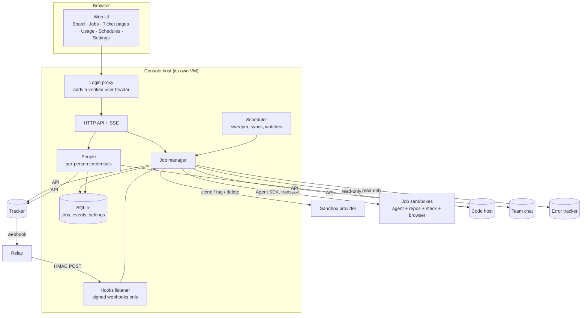
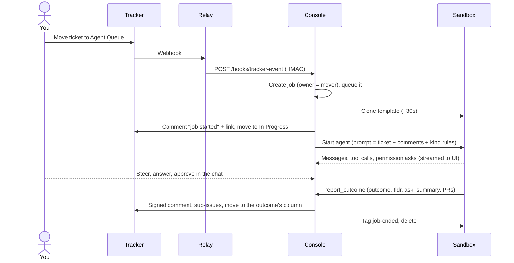

# 2. Architecture

The console is one server process with a SQLite database and a web UI. It sits between your tracker, your
sandboxes and the agent runtime, and it owns nothing those systems already own.

## The pieces



| Piece | Responsibility | Must not |
|---|---|---|
| **API** | Jobs, the chat stream (SSE), board and ticket views, settings, usage, schedules | Hold business rules that belong in the manager |
| **Hooks listener** | Accept only signed webhooks on the one public port | Serve anything else |
| **Job manager** | Queue, provision, run the agent, handle tools, apply outcomes, sequence epics, park, recover | Let an agent write to its own ticket |
| **People** | Each person's credentials and what they may do | Hand secrets to job processes |
| **Scheduler** | Every recurring tick in one registry (see [Scheduled work](09-scheduled-work.md)) | Overlap a run that's already going |
| **Sandboxes** | One per job, cloned from the template, deleted when the job ends | Be shared, or be long-lived |

## The interfaces to implement

Swap providers by implementing these. Everything else in the spec is written against them.

```ts
// Where tickets live.
interface Tracker {
  issue(id): Issue                           // title, description, comments, state, parent, children, attachments
  move(id, column): void
  comment(id, markdown, signature): void
  createIssue({ title, description, parentId?, state? }): Issue
  fileUrl(url): bytes                        // attachments behind auth
  history(id): Move[]                        // who moved it, for ownership
}

// Where jobs run.
interface Sandboxes {
  clone(jobId, name, opts: { stack: boolean }): void    // streams log lines
  tag(name, tags): void
  untag(name, tags): void
  list(): { name, tags }[]
  delete(name): void                                     // guarded, see Sandboxes doc
  exec(name, cmd): string                                // e.g. git ls-remote, ps
  copyOut(name, path) / copyIn(name, path)               // session files for parking
}

// How the agent process is started.
interface Transport {
  executable(job): string     // what the SDK spawns (a local binary, or a wrapper that ssh's into the sandbox)
  env(job): Record<string,string>
  cwd(job): string
}
```

**What I used:** Linear for `Tracker`, exe.dev VMs for `Sandboxes`, and a generated ssh wrapper for `Transport`
(see [Sandboxes](05-sandboxes.md)). The runtime is Claude Code driven through the Claude Agent SDK's `query()` in
streaming-input mode, which gives the console a live message stream, mid-run user messages, interrupts and a
permission callback. Any runtime with those four features fits.

## A ticket's path



## Where state lives

The console stores as little as possible. Everything a person would look for elsewhere stays elsewhere.

| Data | Lives in | Why there |
|---|---|---|
| Tickets, comments, sub-issues, column | Tracker | It's the shared memory between people and agents |
| Code, PRs, reviews, CI | Code host | Same |
| Jobs, the full event log, outcomes, epic/umbrella bookkeeping, settings, schedule state | Console DB | Only the console needs it; it's the audit trail of every run |
| Agent sessions for parked jobs | Console disk | So a parked job can resume on a new sandbox |
| Per-person credentials | Credential proxy where possible, else console DB | See [Security](10-security-and-billing.md) |
| Secrets for the console itself | One env file, mode 600 | Never inherited by jobs |

Back up the DB and the session folder nightly. Losing them loses transcripts and in-flight bookkeeping, but not
the work, which is in the tracker and on branches.

## Code layout that worked

You don't have to follow this, but these boundaries kept the code easy to change:

| Module | Owns |
|---|---|
| `server` | Wiring from env: clients, manager, listeners, schedule registry |
| `app` | HTTP routes and SSE |
| `manager` | Job lifecycle, tool handlers, outcomes, epics, umbrellas, parking |
| `outcome` | The tool definitions the agent sees (one MCP server, in process) |
| `transport` | Local and remote process start |
| `sandboxes` | Clone, tag, delete, copy |
| `tracker`, `codehost`, `chat`, `errors` | Thin API clients |
| `sweeper`, `schedules` | The periodic tick and the registry around every recurring job |
| `prompts` | Loading and composing prompt files |
| `people` | Who's who, their connections, the setup gate |

## Acceptance checks

- A tracker move into an agent column produces exactly one job, even if the webhook is delivered twice.
- A job's whole transcript can be replayed from the event log alone after a console restart.
- Replacing the `Sandboxes` implementation with a local "run in a temp dir" stub runs the same job end to end.
- No job process can read the console's env file or DB.
