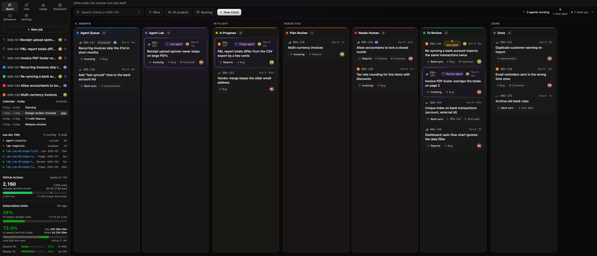
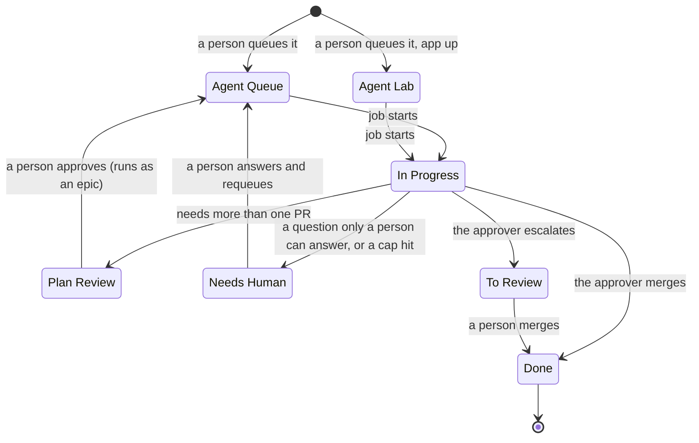
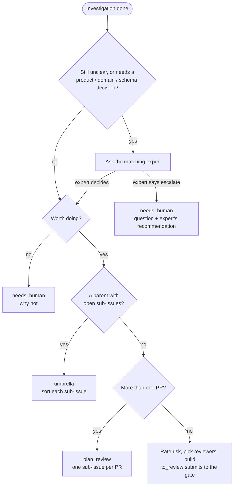

# 3. Board and routing

The tracker's board is the console's input and its output. Moving a ticket into an agent column starts a job, and
the job's outcome decides which column the ticket lands in next.

## Why

- **The board is the interface people already use.** Nobody learns a new tool to hand work to an agent. They drag
  a card.
- **One front door.** Every ticket runs as one build job. Its intake investigates, then builds it, splits it, or
  asks. People never have to pick the right agent.
- **Agents judge, the console writes.** An agent reports one structured outcome, and the console turns it into
  comments, moves and sub-issues. Code does the same thing every time. An agent writing to the tracker directly
  would drift, double-post and race with other jobs.
- **People decide what agents work on.** Agents can file and edit other tickets, but they can never put a ticket
  into an agent column. Every unit of agent work starts with a human move.

## Contract

### Columns



<sub>The board. Cards in agent columns show which agent is on them; the sidebar lists live chats and VMs. Real UI, fictional data.</sub>

| Column | Who acts | What a person sees there |
|---|---|---|
| **Agent Queue** | Build job | Nothing yet; a job starts within seconds |
| **Agent Lab** | Build job, app already up | The same, for a ticket you know needs the running app |
| **In Progress** | A job is running: intake, building, the gate, reviews | A comment linking to the live job chat |
| **Plan Review** | You | A plan, with one sub-issue per PR, to approve or edit |
| **Needs Human** | You | One clear question with a recommendation, or "here's what I tried" |
| **To Review** | You | A PR that passed the gate and every reviewer, with the approver's reason for escalating |
| **Done** | – | Merged, by you or by the approver |

Both agent columns start the same build job. The second only saves the builder the minutes it takes to start the app.
Column names are configuration, not code.



### Inside the job

A build job runs the [pipeline](13-pipeline.md): intake, builder, gate, reviews, approver. Intake decides first and
applies the **first** rule that matches:



Risk doesn't stop the job. "Risky" (prod data, auth and permissions, billing, paid benchmarks) raises the rating,
adds reviewers, and keeps the change away from auto-merge. A one-line change to an auth check still ends with a
person.

### Outcomes

An agent reports through `report_outcome`. After the turn that reported it ends, the console applies the row. Every
outcome but `to_review` and `attempt_failed` ends the session and deletes the sandbox. The job itself ends `done`
whatever the outcome; the column carries the meaning.

| Job kind | Outcome | Column | The console also |
|---|---|---|---|
| build | `to_review` + PRs | (stays In Progress) | starts **the gate**: the run stays up while CI, reviews and the approver run (see [The pipeline](13-pipeline.md)); the first time, comments the report and PR links |
| build | `plan_review` | Plan Review | creates `sub_issues` as children; comments the plan |
| build | `needs_human` | Needs Human | comments the questions or the risk |
| build | `attempt_failed` | (no move) | `attempts += 1`; below 3, tells the agent to start a fresh attempt; at 3, applies `needs_human` |
| build, on a parent | `umbrella` | In Progress | routes each sub-issue (see [Epics and umbrellas](07-epics-and-umbrellas.md)) |
| review | `to_review` / `needs_human` | To Review / Needs Human | comments the review |
| any | job crashed, hit the 8h cap, park failed, or ended with no outcome | Needs Human | comments why |

The pipeline then moves the ticket on its own:

| Pipeline result | Column | The console also |
|---|---|---|
| approver merges | Done | merges each PR at the gated commit; watches the deploy |
| approver escalates | To Review | comments the approver's view and the policy reasons on each PR |
| 5 red gate rounds, CI stuck 90 min, 3 review rounds, a lens that never reports, a PR merged or closed under it | Needs Human | comments which, with the failing log or the findings |
| red deploy after an auto-merge | Needs Human | turns that repo's auto-merge off |

When a job first reaches `running`, the console comments a link to the job's chat and moves the ticket to In Progress.

Every comment has the same shape: a one or two sentence `tldr`, an optional single yes/no `ask`, and the
`summary` folded under "Details". See [The human side](08-humans.md).

### Job kinds

| Kind | Started by | Sandbox | Does |
|---|---|---|---|
| `build` | Ticket into Agent Queue or Agent Lab | No app stack until `start_app` (Agent Lab: up from the start) | The whole pipeline: intake, builder, gate, reviews, approver. On a parent with open sub-issues, intake sorts them instead |
| `review` | A button on a PR, or the PR sync once a person's PR has green CI | No stack | Runs the reviewers on a PR a person opened; one findings comment |
| `test` | A button on a ticket | Full stack on the ticket's branches | Brings the app up for a person to try; waits |
| `error-sweep` | Daily schedule | No stack | Picks up to 3 real errors from the error tracker and files tickets |

### Who is speaking

The console writes to the tracker with one account, so every comment would look like it came from the same person.
Every comment therefore ends with a signature line naming its speaker:

| Speaker | Signature |
|---|---|
| The console's own bookkeeping | `— Agent Console · build job [job_01…](link)` or `— Agent Console` |
| An agent's own words (its outcome) | `— Build agent · job […]`, `— Sort agent · job […]`, `— Review agent · job […]` |
| An interactive agent session | `— Claude (<whose session>)` |
| A person typing in the console | unsigned |

The console parses the line back out. The ticket page shows those comments with an agent author, colored by kind,
and links to the job. Agents reading a ticket see the author as `<name> (an agent, not a person)`, so they don't
treat another agent's guess as a human decision.

With per-person tracker credentials ([The human side](08-humans.md)), the account is the job's owner, and the
signature still says it was an agent.

### Inbound hook

The relay turns tracker webhooks into one call:

```
POST /hooks/tracker-event
X-Console-Signature: hex(hmac_sha256(raw_body, HOOK_SECRET))
{ event, issue_id, identifier, title, url, parent_id, to_state, from_state_id }
```

- `event` is "moved into status" or "created in status". Both are handled the same way.
- The HMAC is over the **raw body bytes**, before JSON parsing. A bad signature returns `401`. A missing secret
  returns `503`, so the hook fails closed.
- `to_state` Agent Queue starts a build job; Agent Lab starts a build job with the app already up. A sub-issue
  moving to Done is also sent (for epics and umbrellas). Anything else returns `202 {ignored: true}`.
- **Idempotent per `(issue_id, to_state)`** while a job for that key is live (any non-terminal state, and
  `needs_human` counts as live). A duplicate returns `200 {job, duplicate: true}`. A new job returns `201 {job}`.
  Relays redeliver, and the console's own moves echo back through the hook. Both must be no-ops.
- `from_state_id` is resolved to a column name. Plan Review → Agent Queue on a ticket with children is an approved
  epic, not a new build job.
- The job's owner is whoever moved the ticket: from the console, or from the tracker's issue history.

### Follow-up chats

A person can message a job after it reported its outcome. That resumes the same session (a follow-up run). When
they press End on a follow-up run:

1. The console asks the agent for a short summary of what changed since the outcome.
2. It posts the reply on the ticket as "Follow-up after the outcome", signed as the agent. A reply of exactly
   `NOTHING` posts nothing.
3. The job ends. The ticket stays where the outcome put it.

Pressing End a second time while the summary is being written ends the job without one. Ending a job that never
reported an outcome sends its ticket to Needs Human.

### Agent writes to other tickets

Agents get `create_ticket` and `update_ticket` for **other** tickets: a follow-up, a bug found on the way, a
comment on a related ticket. Rules:

- Their own ticket moves only through `report_outcome`.
- Agent Queue and Agent Lab are refused as target states.
- New tickets land in Backlog, assigned to the job's owner and linked as related. Max 10 per job.
- Every write shows in the job's chat.

## Acceptance checks

- Moving a ticket into Agent Queue creates exactly one build job, and the hook returns `201`. Agent Lab does the same,
  with the app up when the agent starts.
- Replaying the same signed body returns `200 {duplicate: true}` and creates nothing.
- A body with one byte changed returns `401`. With the secret unset, the hook returns `503`.
- A move into any other column returns `202 {ignored: true}`.
- Each outcome in the table produces the listed column and comment, and the comment carries the right signature.
- A build job that reports `attempt_failed` three times ends in Needs Human with all three attempts summarized.
- A build job that reports `to_review` stays In Progress and keeps running until the approver merges or escalates.
- `update_ticket` with state Agent Queue is refused, and the refusal shows in the chat.
- Ending a follow-up run posts the summary. Ending it with a `NOTHING` reply posts nothing.
- The console's own move to In Progress does not create a second job.

## What I used

- **Linear** for the tracker. The webhook goes through a small relay service that was already running, so I only
  needed to fix its payload format. The console can just as well take the tracker's webhook directly.
- Column names come from env vars, so renaming a column is a config change.
- One Linear API key for the console's own writes at first. Per-person tracker credentials came later.
