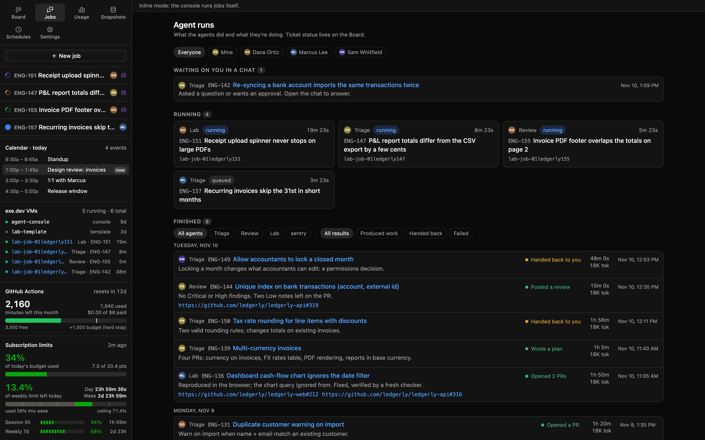
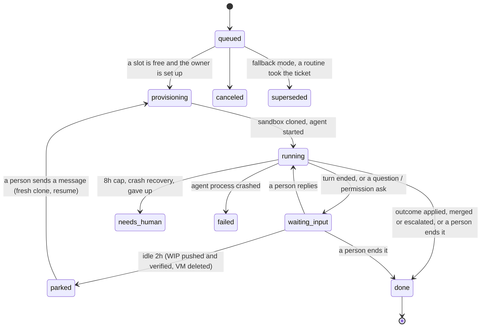
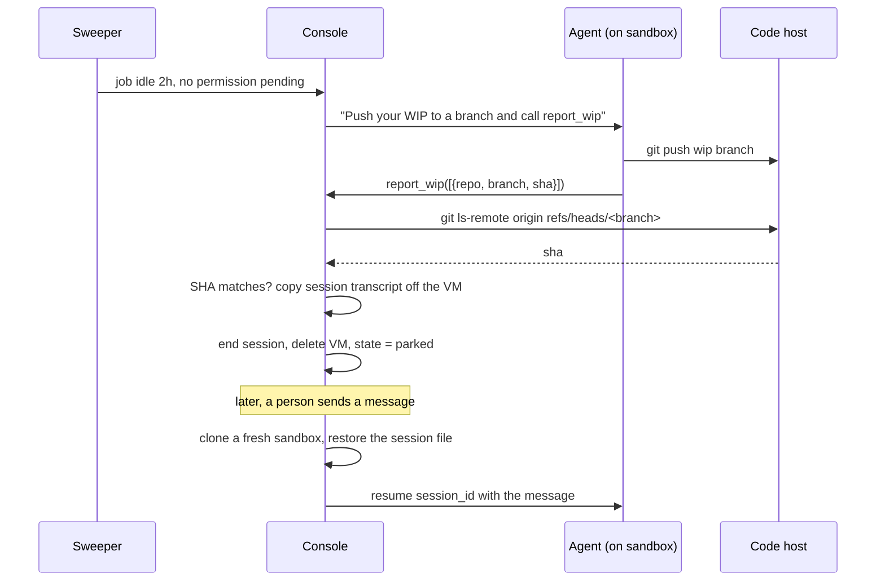

# 5. Jobs

A job is one agent run on one ticket in one sandbox. This doc covers the record, the states, the limits, and how a
job survives restarts and idle time.

## Why

Every job, labelled by what it did rather than the column it set. Real UI, fictional data.

- **The transcript is the job.** Every SDK message, human message, permission request and console note goes into
  one append-only log. The UI, the usage numbers, recovery and summaries all read from it.
- **Like a terminal session, not a batch run.** When a turn finishes, the session stays open waiting for you,
  the same way an interactive agent sits idle at its prompt. You end it, or you say something and it continues.
- **Everything ends.** A concurrency cap, a 2h idle park and an 8h hard cap mean no job holds a VM for weeks. (The
  setup this replaced had one session hold a box for 54 days.)
- **Restarts lose nothing important.** Sessions are resumable by id, so a console restart moves jobs aside instead
  of killing them silently.

## Contract

### The job record

| Field | Type | Notes |
|---|---|---|
| `id` | text | `job_<ulid>` |
| `kind` | enum | `build`, `review`, `test`, `error-sweep` |
| `stage` | enum \| null | build jobs: `intake`, `build`, `gate`, `review`, `approve`. Every change is a `stage` event `{from, to, why}` |
| `rounds` | json | `{gate, review}`: red CI handed back (cap 5) and review changes handed back (cap 3) |
| `gate` | json \| null | from the first PR on: the PRs and the commit each was checked at, the lenses, the reviews, the deploy watch |
| `umbrella` | bool | a build job on a parent that sorts its sub-issues ([Epics and umbrellas](08-epics-and-umbrellas.md)) |
| `issue_id`, `identifier`, `title`, `url`, `parent_id` | text | from the tracker event; null for ticketless jobs |
| `owner` | text | the person the job acts for (whose subscription, whose name) |
| `state` | enum | see below |
| `transport` | `local` \| `remote` \| `routine` | where the agent runs; `routine` = fallback mode, read-only feed |
| `vm` | text \| null | sandbox name; null until provisioned and again once deleted |
| `session_id` | text \| null | the agent session id, for resume |
| `prompt` | text | the first human message (built from the ticket and its comments) |
| `model` | text \| null | null = the runtime's default |
| `prompt_versions` | json | `{file: version}` for every prompt file the job was built from, stamped at start. Lets scores line up with prompt edits ([Self-improvement](13-self-improvement.md)) |
| `pid` | int \| null | local pid of the agent process (or its ssh wrapper) while it runs |
| `hook_key` | text \| null | `<issue_id>:<to_state>`, for idempotency |
| `base_branch` | text \| null | `feature/<parent>` for an epic child or epic final, else main |
| `attempts` | int | build: failed fix attempts so far |
| `outcome` | json \| null | the last `report_outcome` payload |
| `wip` | json \| null | `[{repo, branch, sha}]` pushed and verified before parking |
| `park_requested_at` | time \| null | when the sweeper asked the agent to push WIP |
| `usage` | json | tokens and the billing source from the session's init message |
| `created_at`, `started_at`, `last_event_at`, `ended_at` | time | `started_at` is the latest entry into `provisioning`; the 8h cap runs from it |
| `superseded_by` | text \| null | fallback mode: the routine run that took this ticket |

### States

- **`waiting_input`** means the job waits on a person: a permission request, a question, or simply a finished
  turn with nothing pending.
- **An interrupt** ends the current turn the same way. "Continue" is just the next message.
- **`parked`** is neither live nor terminal. It holds no VM, and a message wakes it.
- **`needs_human`** (the job state) is for console-level trouble. An agent asking a question ends the job `done`
  with its *ticket* in Needs Human.
- **Through the pipeline.** A build job that reports `to_review` stays live while the gate, the reviews and the
  approver run. Its turn ends and it sits in `waiting_input` until the console hands it a red log or review findings,
  which start the next turn. It ends `done` when the approver merges or escalates.
- **Resume.** A message to a `needs_human`, `done`, `failed` or `canceled` job that has a `session_id` resumes
  that session on a fresh sandbox, back through the cap.

### The cap

At most `MAX_JOBS` (default 3) jobs are in `provisioning`, `running` or `waiting_input` at once. The rest stay
`queued` in order. A job whose owner hasn't connected their accounts stays `queued` with a note until they do.
Nothing silently runs on someone else's plan.

The cap exists because every job draws on a subscription's usage limits, including the limit the owner uses
interactively.

### Restart recovery

On console start:

1. Every job in `provisioning`, `running` or `waiting_input` → `needs_human`, with a log event saying why. It keeps
   its `session_id`, so a message resumes it.
2. Its old agent process can outlive a killed console until its current tool returns. Send it SIGTERM, **but only
   if** `pid` still belongs to an SDK-driven process (its argv contains the stream-json flag). A reused pid won't
   match. This ensures a resume never runs two processes on one session.
3. Unanswered permission requests get an `aborted` response event, so the UI doesn't show dead buttons.
4. A job left in `provisioning` may have a half-made VM. Find it by its `job-<id>` tag and delete it.
5. A VM kept for a person (a job moved to `needs_human`) is tagged `keep` so the reaper skips it.

### Parking

- Only remote jobs park. Local jobs never do.
- Verification is by SHA on the remote, never by trusting the agent's word.
- If nothing verifies within 15 minutes, the job → `needs_human` and the VM is kept (tagged `keep`).
- Live, a resume on a fresh clone took about 15 seconds.

### Hard limits

| Limit | Value | What happens |
|---|---|---|
| Concurrency | `MAX_JOBS` = 3 | the rest queue |
| Idle | 2h in running/waiting_input with no event | park |
| Run length | 8h from `started_at` | end, delete VM, `needs_human` |
| Fix attempts | 3 `attempt_failed` | ticket to Needs Human |
| Gate rounds | 5 red CI rounds | ticket to Needs Human |
| Gate time | CI not finished within 90 min | ticket to Needs Human |
| Review rounds | 3 rounds of changes | ticket to Needs Human, with the findings |
| Auto-merges | a daily cap (mine: 3) | the approver escalates |
| Deploy watch | 2h after an auto-merge | red: ticket to Needs Human, the repo's auto-merge off |
| Stuck ticket | in an agent column 10 min with no live job | ticket to Needs Human |

### Events

Append-only `job_events (seq, job_id, at, type, data)`, also streamed to the UI over SSE (resume with
`Last-Event-ID` = `seq`).

| Type | Data |
|---|---|
| `sdk` | a raw runtime message: assistant, user (tool results), result, system/init |
| `human` | a message a person sent |
| `interrupt` | a person stopped the turn |
| `permission_request` / `permission_response` | the tool, its input, allow / deny / aborted |
| `state` | `{from, to}` |
| `stage` | build jobs: `{from, to, why}` |
| `review` | one reviewer's verdict, summary and findings |
| `log` | the console's own note (provisioning output, sweeper actions, refusals) |
| `summary` | a small model's one-line summary of a run of tool calls, for the chat |
| `runner` | fallback mode: a routine's hook event |

### Billing guard

Record the init message's billing source on every job. Anything other than the billing you chose marks the job
`failed`. If you chose subscription billing, refuse to start any job while an API key variable is set in the
console's environment. See
[Security and billing](11-security-and-billing.md).

## Acceptance checks

- Two jobs run at once, each with its own transcript. Messages never cross.
- A message mid-run changes what the job does. Interrupt stops the turn and the job goes to `waiting_input`.
- A fourth job stays `queued` while three are live, and starts when one ends.
- Kill the console with SIGKILL mid-run and start it again. The job is `needs_human`, its old process is gone,
  pending permission buttons show "aborted", and a message resumes the same session with its memory intact.
- A pid reused by an unrelated process is not signaled.
- A job left idle for 2h parks: WIP branch on the remote at the reported SHA, VM gone, state `parked`. A message
  brings it back on a new VM in the same session.
- An agent that reports a WIP SHA that doesn't match the remote does not get parked. After 15 min it's
  `needs_human` with its VM kept.
- A job past 8h is ended and its VM deleted.
- Every job's usage shows the subscription as its billing source.

## What I used

- **SQLite** (WAL mode) for jobs and events. One file, easy to back up nightly.
- The **Claude Agent SDK** `query()` in streaming-input mode: one long-lived async input queue per job, so
  messages, interrupts and permission answers go into the live session.
- Permission mode `default`, so tool approvals come to the console's UI. The sandbox template pre-allows the
  safe tools so only unusual ones ask.
- SSE for the live chat, one stream per open job.
