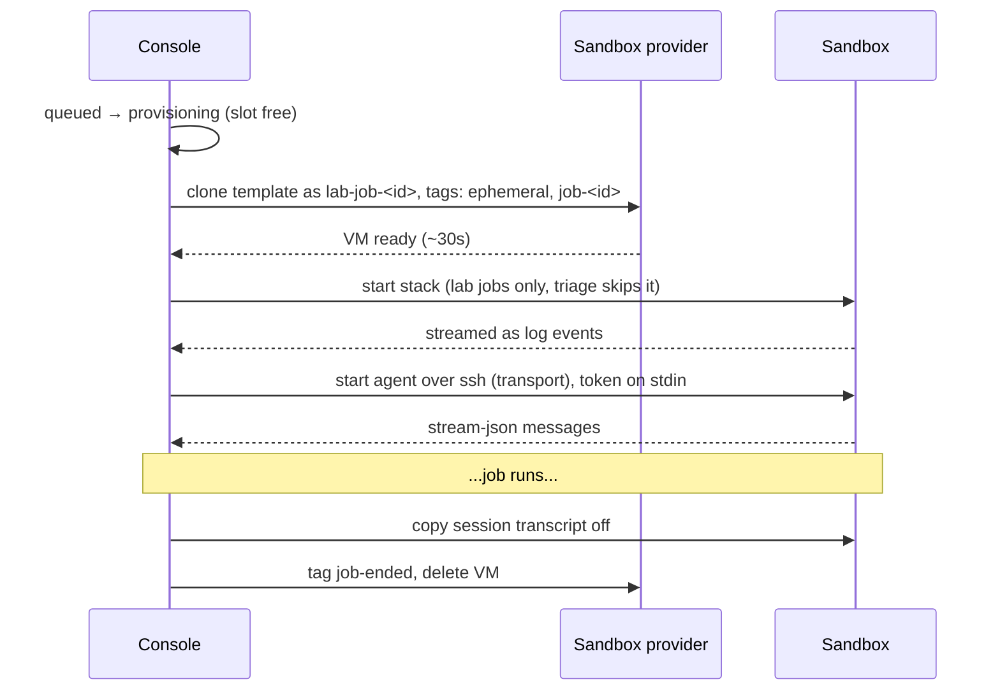

# 5. Sandboxes

Every job runs in its own throwaway VM, cloned from one template and deleted when the job ends. The console never
runs an agent on its own machine.

## Why

- **No collisions.** Two jobs never share a database, ports, a test DB or a half-finished migration. The setup this
  replaced had three long-lived shared boxes, and one session's test data leaked into the next.
- **The console is protected.** Agents can't read its database, its secrets or its tracker key.
- **Realistic by default.** The template has the full app stack, scrubbed data and a headless browser, so an agent
  can reproduce a UI bug the way a person would.
- **Nobody remembers how a hand-built box was made.** A template rebuilt by script is documentation that runs.
- **Cleanup is one rule.** Job ends, VM deleted. A reaper catches what a crash left behind.

## Contract

### The template

| Comes with | Notes |
|---|---|
| Your repos | checked out, dependencies installed |
| Toolchain | language runtimes, package managers, linters, the agent CLI pinned to a version |
| The app stack | DB, queues, workers, API, frontend, started the same way as on a laptop, with hot reload |
| Seed data | a scrubbed copy of production (people, emails, phones and message bodies removed) |
| Headless browser | driven by the agent through a DevTools MCP server |
| A test login | a throwaway user in the VM's own DB, credentials in a file in the home dir |
| Agent settings | the repos' own skills, subagents and project instructions load as usual |
| Tool permissions | safe tools pre-allowed; dangerous commands denied (pushing to main, prod access, full test suites) |
| Credentials | none on disk. Code host, email, cloud storage go through the sandbox provider's auth proxies |

### Clone flow



- The VM name is derived from the job id with the clone script's own normalization (lowercase; anything outside
  `[a-z0-9-]` becomes `-`), so the console and the script always agree on it.
- Clone output streams into the job's chat as `log` events, so a provisioning failure is visible.

### Triage without the stack

Triage sandboxes skip the app stack, which makes them fast. Most tickets don't need it. When triage can't decide
without seeing the UI (a screenshot-only ticket, "this looks wrong"), it calls a `start_app` tool that brings the
stack up in a few minutes. It looks, captures screenshots, and then routes. It doesn't fix UI bugs; those go to the
Lab with a precise handoff note.

### Delete safety

The console deletes a VM only if **all** of these hold:

1. Its name matches `lab-job-…` and equals the job's `vm` field.
2. The provider's listing shows the tags `ephemeral` and `job-<id>`.
3. It's not on the denylist: the template, the console's own VM, and any named long-lived boxes.

A bug in the job-ending code can then delete, at worst, that job's own sandbox.

| Tag | Meaning |
|---|---|
| `ephemeral` | may be reaped |
| `job-<id>` | belongs to this job |
| `job-ended` | set just before delete; a reaper deletes leftovers with it |
| `keep` | kept for a person to look at (restart recovery, park failure). The reaper skips it. Removed when the job ends. |

A separate **reaper** (hourly timer, outside the console's process) deletes `ephemeral` VMs that have no `keep`
tag and are past their age, so a crashed console doesn't leak VMs.

### Transport

```
interface Transport {
  executable(job): string   // path passed to the SDK as the agent executable
  env(job): Record<string,string>
  cwd(job): string
}
```

- **local**: the agent CLI on the console's machine. Development only; off in production.
- **remote**: the console generates a small wrapper script per job and passes it to the SDK as the agent
  executable. The wrapper runs `ssh <vm> 'cd <repo> && <agent-cli> --add-dir <other-repo> "$@"'`. The SDK's
  stream-json stdio passes straight through ssh. **No relay process on the VM is needed.**
- **Auth token**: the subscription token is sent as the **first line of the ssh session's stdin**. The remote
  shell reads it into an env var and then execs the agent. It's never in a file, never on a command line, never in
  the wrapper. Each job gets its owner's token.
- **Withheld env.** The agent process never inherits the tracker key, the hook secrets, or any API key variable. The
  transport builds the env from an allowlist instead of copying the console's.

### Production data, safely

When a bug lives in production data, the agent needs that data without touching production.

| Tool | What it does | Limits |
|---|---|---|
| `load_snapshot` | Loads the newest scrubbed prod snapshot into the sandbox's DB, then migrations and a fresh test login | a new snapshot at most every 6h across all jobs; reason required |
| `fetch_prod_documents` | Copies specific files (by id from the snapshot DB) into a dev bucket so they open in the sandbox | 25 per call, 200 a day; each file copied once; reason required |

- Snapshots are made **inside** production by a scheduled job that scrubs and exports them, and stored in a dev bucket.
  The sandboxes never hold a production identity.
- Every call is logged with its reason on a Snapshots page.
- Prompts forbid browsing and forbid pasting personal data into PRs or tickets. Screenshots go on the ticket,
  never in the PR.

## Acceptance checks

- A clone boots to a ready stack (health endpoint 200, frontend responds) in the time you measured and wrote down.
- Headless Chrome on a clone loads the app and logs in with the test user.
- Two lab jobs run at once without seeing each other's data.
- After a job ends, its VM is gone and the template and the console's VM are untouched.
- Asking the delete function for a VM without the job's tag, or for the template by name, refuses.
- A VM tagged `keep` survives the reaper. The tag comes off and the VM is deleted when its job ends.
- The token appears in no file on the VM, no process argv (`ps`), and not in the wrapper script.
- `env` inside a job shows none of the console's secrets.
- The agent can load a snapshot and fetch two documents. Both calls appear in the audit log with the reason.

## What I used

- **exe.dev** VMs: clone from a template VM, tags, `ssh exe.dev ls/cp/tag/rm`, and built-in HTTP proxies
  for the code host and other integrations, so no tokens sit on the VM. Any provider with fast clones, tags and ssh
  works.
- Measured: a clone with the stack up in about 30 seconds; the template rebuilt by script in about 6 minutes.
- Chrome DevTools MCP for the browser. No Playwright needed for proof.
- The clone and reaper scripts live with the app repo that defines the stack. The console calls them by path.
- The console VM's key for the provider CLI has to be account-wide (VM-scoped keys can't call the provider's
  CLI). That's a known weak point: see [Security and billing](10-security-and-billing.md).
