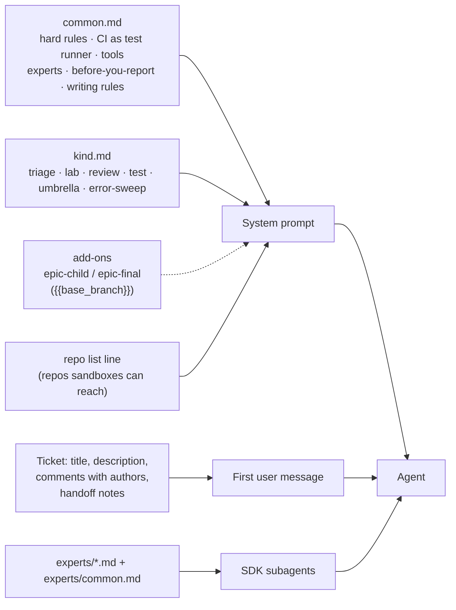
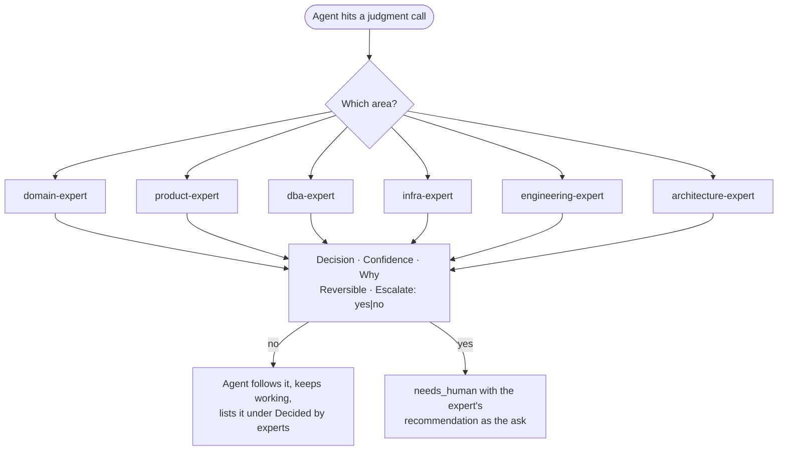

# 6. Agent tools, prompts and experts

The agent's world is three things: the **prompt** for its job kind, the **tools** the console gives it, and the
**experts** it can ask. Together they encode the process.

## Why

- **Tools are the contract.** The agent can't comment on or move its own ticket. It calls `report_outcome` once,
  with a fixed schema, and the console does the rest. That one choke point makes runs comparable, auditable and
  safe to automate around.
- **The console proxies anything that needs a credential.** Tracker attachments, team chat and error-tracker reads
  go through console tools that use the owner's connection. The sandbox never holds those tokens, and every read
  is logged in the chat.
- **Prompts are files, not code.** One shared file plus one per kind, with frontmatter for the model and blocked
  tools. Process changes become prompt diffs that anyone can review.
- **Experts replace "waiting on Bob".** Agents kept parking tickets on "a person must decide". Most of those
  decisions were things a well-briefed senior person would just decide. Expert subagents make them and record
  them, and they escalate only show-stoppers.

## Tool contract

All tools live on one in-process MCP server (call it `console`). They are auto-approved. Everything else the
agent does goes through the normal permission flow.

| Tool | Who gets it | Does |
|---|---|---|
| `report_outcome` | every job | The one result. Ends the job's work; the console applies it after the turn ends |
| `report_wip` | every sandboxed job | When asked to park: the branches it pushed, which the console verifies |
| `attach_screenshots` | every job | Upload proof to the ticket now (follow-up chats); at the end use `report_outcome.screenshots` |
| `tracker_issue` | every job | Read another ticket: description, comments, children, links |
| `tracker_file` | every job | Read an attachment that needs tracker auth |
| `create_ticket` | most jobs | File a follow-up or found bug. Lands in Backlog, assigned to the owner, linked as related, max 10 per job |
| `update_ticket` | most jobs | Comment on, edit or move *another* ticket. Agent columns are refused |
| `chat_search`, `chat_thread` | every job | Read team chat for context. Never DMs, always logged |
| `errors_list`, `error_issue` | every job | Read the error tracker (stack, breadcrumbs, tags) |
| `error_resolve`, `file_error_ticket` | error sweep only | See [Scheduled work](09-scheduled-work.md) |
| `start_app` | triage | Bring the stack up on demand when triage must see the UI |
| `load_snapshot`, `fetch_prod_documents` | triage, lab | Scrubbed prod data, capped and audited |

### `report_outcome`

```ts
report_outcome({
  outcome: 'to_review' | 'plan_review' | 'agent_lab' | 'needs_human' | 'attempt_failed' | 'umbrella',
  tldr: string,          // ≤300 chars, 1–2 plain sentences: the result and what it means. No paths, IDs, flags.
  ask?: string,          // ≤300 chars, only if a person is needed: ONE yes/no question + your recommendation + cost/risk
  summary: string,       // markdown details, folded under "Details" in the comment
  pr_urls?: string[],
  screenshots?: string[],                              // ≤8 absolute paths in the sandbox, uploaded to the ticket
  sub_issues?: { title, description }[],               // plan_review: one per PR
  children?: { id, route: 'agent'|'agent_draft'|'human', reason }[],  // umbrella: exactly one per listed sub-issue
})
```

Rules the console enforces:

- Validate against the job kind and reject back to the agent with the reason. For example, an umbrella `children` list that
  doesn't match the listed sub-issues one-to-one gets rejected.
- Apply the outcome **after the turn that reported it ends**, so the agent's closing sentence lands in the transcript.
- `attempt_failed` (lab) increments `attempts`. Below 3, the console tells the agent to start a fresh attempt. At 3
  it applies `needs_human`.
- The comment the console posts is: tldr, then the ask (if any) in bold, then `<details>` with the summary, then
  PR links and screenshots, then the signature line.

## How prompts compose



- **Frontmatter** on each kind sets `model` (triage and experts on the strongest model; summaries on a small one)
  and `disallowedTools` (umbrella and error-sweep can't edit files, review can't drive the browser).
- **The first message is the ticket**, including every comment with its author. Comments the console signed are
  shown as `<name> (an agent, not a person)` so agents don't treat an earlier agent's guess as a human decision.
- **The project's own instruction files still load.** The runtime loads the repo's skills, subagents and
  instruction file, so the console's prompts add the process on top of the codebase's conventions without
  repeating them.

The templates are in [`prompts/`](../prompts/).

## Experts before people



**Contract.** Experts are read-only subagents (reading code, docs, tickets and chat; no edits, no writes) run on the
job owner's account. Each answers in exactly this shape:

```
Decision: <specific enough to build>
Confidence: high | medium | low - <why>
Why: <evidence: file:line, doc, ticket, thread>
Reversible: yes | no - <what undoing takes>
Escalate: no | yes - <which rule, and the exact question for a person>
```

**Escalate only for:** changing results customers already rely on, at scale, without a decided policy; legal or
regulatory interpretation with liability; irreversible production data changes; security, auth, permissions,
billing or money; or a true one-way door with evidence split evenly. Low confidence alone is not a reason to
escalate. The expert decides and says what a reviewer should check.

**Why it's safe:** a person reviews the PR or plan anyway. A wrong expert call costs one review comment, while a
question parked on a person costs days. Every expert decision goes into the summary under **Decided by experts**
(question, decision, expert, confidence), so the reviewer can overrule it without digging.

**The domain expert is the interesting one.** Mine stood in for the one person on the team who knew the business
domain cold. I wrote down how that person thinks: the rules, the edge cases, what "correct" means to customers, and
which questions really need them. Agents then stopped queueing on that person. Write yours with them, not about
them.

## Acceptance checks

- An agent that tries to comment on its own ticket through `update_ticket` is refused with a message pointing to
  `report_outcome`.
- `create_ticket` / `update_ticket` refuse agent columns.
- A malformed `report_outcome` comes back to the agent as a tool error, and nothing is written to the tracker.
- A triage run on a vague ticket shows at least one expert consultation and a **Decided by experts** list, and
  its `ask` (if any) is a single yes/no question.
- Every chat read and prod-data call appears as a visible line in the job's transcript.
