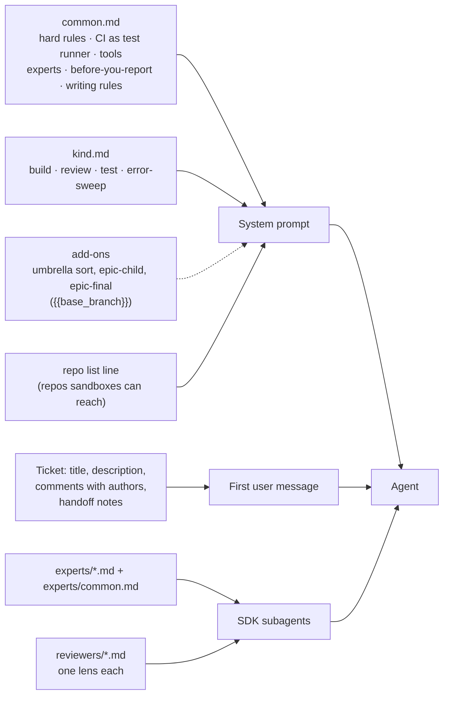
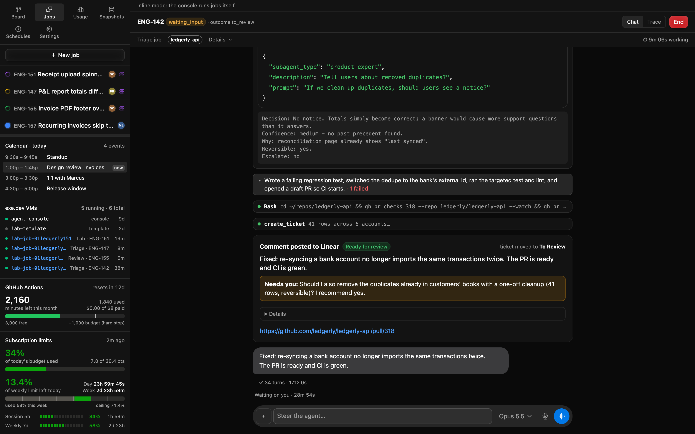
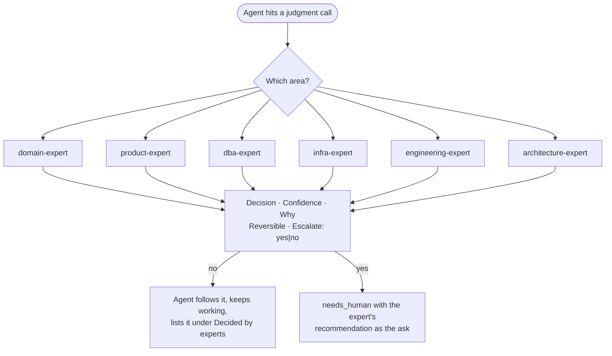

# 7. Agent tools, prompts and experts

The agent's world is three things: the **prompt** for its job kind, the **tools** the console gives it, and the
**experts** it can ask. Together they encode the process.

## Why

- **Tools are the contract.** The agent can't comment on or move its own ticket. It calls `report_outcome` with a
  fixed schema, and the console does the rest. Reviewers call `report_review`, so each verdict is on record in
  the reviewer's own words. That one choke point makes runs comparable, auditable and
  safe to automate around.
- **The console proxies anything that needs a credential.** Tracker attachments, team chat and error-tracker reads
  go through console tools that use the owner's connection. The sandbox never holds those tokens, and every read
  is logged in the chat.
- **Prompts are files, not code.** One shared file plus one per kind, with frontmatter for the model and blocked
  tools. Process changes become prompt diffs that anyone can review.
- **Experts replace "waiting on Bob".** Agents kept parking tickets on "a person must decide". Most of those
  decisions were things a well-briefed senior person would just decide. Expert subagents make them and record
  them, and they escalate only show-stoppers.

## Tool contract

All tools live on one in-process MCP server (call it `console`). They are auto-approved, except the tools that
reach production, which always wait for a person (below). Everything else the agent does goes through the normal
permission flow.

| Tool | Who gets it | Does |
|---|---|---|
| `report_outcome` | every job | The result. The console applies it after the turn ends; `to_review` submits the PRs to the gate |
| `report_review` | reviewer subagents in a build or review job | One lens's verdict and findings. Refused outside the review stage. See [The pipeline](03-pipeline.md#contract) |
| `report_wip` | every sandboxed job | When asked to park: the branches it pushed, which the console verifies |
| `attach_screenshots` | every job | Upload proof to the ticket now (follow-up chats); at the end use `report_outcome.screenshots` |
| `tracker_issue` | every job | Read another ticket: description, comments, children, links |
| `tracker_file` | every job | Read an attachment that needs tracker auth |
| `tracker_search` | every job | Find tickets in one call: text, state, label, assignee, project, updated since. Read-only |
| `create_ticket` | most jobs | File a follow-up or found bug. Lands in Backlog, assigned to the owner, linked as related, max 10 per job |
| `update_ticket` | most jobs | Comment on, edit or move *another* ticket. Agent columns only after a person wrote in the chat |
| `start_sub_issues` | build | A person in the chat asks to build a ticket that has sub-issues: start them as an epic (the same as approving its plan). Refused until a person has written in the chat; the chat then becomes the epic's coordinator |
| `message_ticket` | build, within one epic | Message the parent's or a sibling's chat. A finished chat resumes for one turn to answer. Capped per job; shows in both chats |
| `epic_status` | build, within one epic | Every sub-issue's order, state, newest job, outcome and PRs. Read-only |
| `chat_search`, `chat_thread` | every job | Read team chat for context. Never DMs, always logged |
| `errors_list`, `error_issue` | every job | Read the error tracker (stack, breadcrumbs, tags) |
| `error_resolve`, `file_error_ticket` | error sweep only | See [Scheduled work](10-scheduled-work.md) |
| `start_app` | build | Bring the stack up on demand on the job's own sandbox |
| `load_snapshot`, `fetch_prod_documents` | build | Scrubbed prod data, capped. **Needs a person's approval** |
| `prod_query` | build | One read-only SQL query against production. **Needs a person's approval** |
| `propose_prompt_edit` | improver only | Save a *proposed* prompt version citing the failing jobs. Never live until a person approves. See [Self-improvement](13-self-improvement.md) |

### `report_outcome`

```ts
report_outcome({
  outcome: 'build' | 'to_review' | 'plan_review' | 'needs_human' | 'attempt_failed' | 'umbrella',
  tldr: string,          // ≤300 chars, 1–2 plain sentences: the result and what it means. No paths, IDs, flags.
  ask?: string,          // ≤300 chars, only if a person is needed: ONE yes/no question + your recommendation + cost/risk
  summary: string,       // markdown details, folded under "Details" in the comment
  pr_urls?: string[],                                  // to_review: the PRs the gate checks
  risk?: 'low' | 'medium' | 'high',                    // build, to_review: the approver's policy reads it; never below intake's
  reviewers?: ('security'|'data'|'product'|'domain')[], // build, to_review: lenses on top of code review
  screenshots?: string[],                              // ≤8 absolute paths in the sandbox, uploaded to the ticket
  sub_issues?: { title, description }[],               // plan_review: one per PR
  children?: { id, route: 'agent'|'agent_draft'|'human', reason }[],  // umbrella: exactly one per listed sub-issue
})
```

Rules the console enforces:

- Validate against the job kind and reject back to the agent with the reason. For example, an umbrella `children` list that
  doesn't match the listed sub-issues one-to-one gets rejected.
- Apply the outcome **after the turn that reported it ends**, so the agent's closing sentence lands in the transcript.
- Intake reports `build`, `plan_review` or `needs_human`; the builder `to_review`, `needs_human` or
  `attempt_failed`. Anything else is refused back to the agent.
- `build` hands the ticket to the builder: the summary is its brief (see [The pipeline](03-pipeline.md#builder)).
- `to_review` needs `pr_urls` and `risk`. It moves the job to the gate and the run stays up (see
  [The pipeline](03-pipeline.md)).
- `attempt_failed` increments `attempts`. Below 3, the console tells the agent to start a fresh attempt. At 3
  it applies `needs_human`.
- The comment the console posts is: tldr, then the ask (if any) in bold, then `<details>` with the summary, then
  PR links and screenshots, then the signature line.

### Production tools need a person

Each console tool is declared `prod: true` or not. The permission callback auto-allows the console's own tools
**unless** they're `prod: true`. Those fall through to the same approval path as any other tool, so the job goes to
`waiting_input` and the request shows in the chat.

- **One approval per call.** No "always allow" for a prod tool, for a job or for a session.
- **The card shows everything.** The tool, the full input (the SQL, the document ids), the agent's reason, and a red
  Production badge. The person can edit the input before approving, for example to tighten a `WHERE`. The log
  keeps both versions.
- **The approver is recorded.** The approval endpoint takes the person's identity from the login proxy. A prod
  approval with no identity (a local console with no proxy) is refused.
- **Unanswered requests expire** after 2h, and the job parks as usual.
- **One log for all of it.** An append-only `prod_access` table, never updated in place, holds a row per request:

| Field | Notes |
|---|---|
| job, ticket, job kind, tool | where it came from |
| `input_requested`, `input_approved` | what the agent asked for, and what actually ran |
| `reason` | the agent's own words, required by the tool's schema |
| `requested_at`, `decision`, `decided_by`, `decided_at` | `approved`, `denied`, `aborted` or `expired` |
| `result` | row count, files copied, run link, error. **Never the rows themselves** |

The Production access page lists it newest first, filtered by tool, job, approver and decision. Each row links to
the job's chat at the moment of the request. The ticket also gets a one-line comment: *"Production query approved
by …: reason"*.

This works because of one fact you must keep true: **only console tools can reach production.** The sandboxes hold
no production credentials, so there's no Bash command to catch. If you ever give a sandbox a prod identity, this
gate means nothing.

## How prompts compose



- **Frontmatter** on each kind sets `model` (build, reviewers, the approver and experts on the strongest model;
  summaries on a small one) and `disallowedTools` (the umbrella sort and error-sweep can't edit files, review can't
  drive the browser).
- **Reviewers and the approver are prompt files too.** One file per lens ([`prompts/reviewers/`](../prompts/reviewers/)),
  passed to the job as subagents beside the experts, and one for the approver model with its answer shape
  ([`prompts/approver.md`](../prompts/approver.md)).
- **The console's mid-job messages are files.** What it sends a build job on red CI, green CI and review changes
  lives in [`prompts/messages/`](../prompts/messages/), so the wording is reviewed like any prompt.
- **The first message is the ticket**, including every comment with its author. Comments the console signed are
  shown as `<name> (an agent, not a person)` so agents don't treat an earlier agent's guess as a human decision.
- **The project's own instruction files still load.** The runtime loads the repo's skills, subagents and
  instruction file, so the console's prompts add the process on top of the codebase's conventions without
  repeating them.

The templates are in [`prompts/`](../prompts/): start with [`common.md`](../prompts/common.md) and
[`intake.md`](../prompts/intake.md) and [`builder.md`](../prompts/builder.md).

## Experts before people



<sub>An expert's answer in the fixed shape (top), then the outcome the console posted: tldr, one ask, folded details. Real UI, fictional data.</sub>



**Contract.** Experts are read-only subagents (reading code, docs, tickets and chat; no edits, no writes) run on the
job owner's account. Each answers in exactly this shape:

```
Decision: <specific enough to build>
Confidence: high | medium | low - <why>
Why: <evidence: file:line, doc, ticket, thread>
Reversible: yes | no - <what undoing takes>
Escalate: no | yes - <which rule, and the exact question for a person>
```

**Escalate only for:** changing results customers already rely on, at scale, without a decided policy; legal or
regulatory interpretation with liability; irreversible production data changes; security, auth, permissions,
billing or money; or a true one-way door with evidence split evenly. Low confidence alone is not a reason to
escalate. The expert decides and says what a reviewer should check.

**Why it's safe:** a person approves every plan, and every PR passes reviewers and an approver that keeps risky
changes for a person. A wrong expert call costs one review comment, while a question parked on a person costs days.
Every expert decision goes into the summary under **Decided by experts** (question, decision, expert, confidence),
so the reviewers and the approver see it, and a person can overrule it without digging.

**The domain expert is the interesting one.** Mine stood in for the one person on the team who knew the business
domain cold. I wrote down how that person thinks: the rules, the edge cases, what "correct" means to customers, and
which questions really need them. Agents then stopped queueing on that person. Write yours with them, not about
them.

## Acceptance checks

- A `prod: true` tool call waits for a person even though every other console tool is auto-allowed.
- Approving it records the approver's identity. With no identity, the approval is refused.
- An approved, an edited-then-approved, and a denied prod call each leave one `prod_access` row with both inputs.
- An agent that tries to comment on its own ticket through `update_ticket` is refused with a message pointing to
  `report_outcome`.
- `create_ticket` / `update_ticket` refuse agent columns unless a person has written in the job's chat.
- `start_sub_issues` is refused until a person has written in the chat. `message_ticket` reaches only the same epic's
  parent and siblings.
- A malformed `report_outcome` comes back to the agent as a tool error, and nothing is written to the tracker.
- A build job's intake on a vague ticket shows at least one expert consultation and a **Decided by experts** list, and
  its `ask` (if any) is a single yes/no question.
- Every chat read and prod-data call appears as a visible line in the job's transcript.
