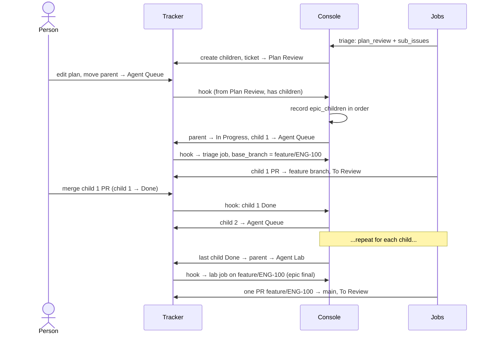
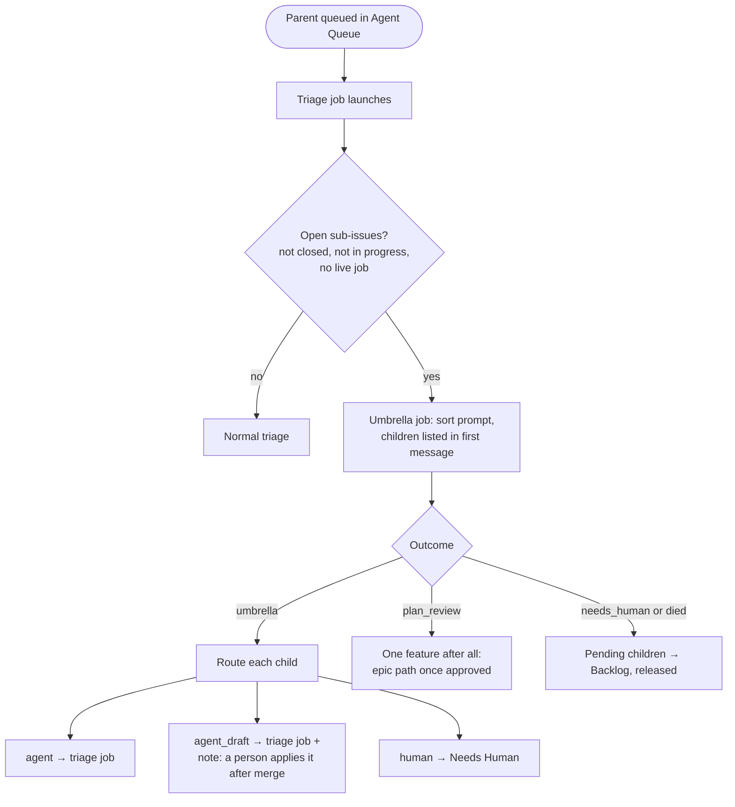

# 7. Epics and umbrellas

Two ways a ticket with sub-issues becomes agent work. An **epic** is one feature split into ordered parts that land
on a shared feature branch. An **umbrella** is a parent whose sub-issues are independent tasks that just need sorting.

| | Epic | Umbrella |
|---|---|---|
| Where it comes from | Triage reported `plan_review`, and a person approved the plan | A person queued a parent that already has sub-issues |
| Children | parts of one feature, in order | independent tasks |
| Branch | `feature/<parent>` | each child on its own, to main |
| Runs | one child at a time | all at once, under the cap |
| Ends with | a whole-feature Lab job and one PR to main | the parent closing when every child is closed |

## Why

- **A person reviews twice, not N times.** Once for the plan, once for the final PR. Child PRs merge into the
  feature branch so the next child builds on them.
- **Advance on Done, not on To Review.** A child is finished when its PR is **merged** into the feature branch.
  Starting the next child at To Review would build on unmerged code.
- **Code sequences, not agents.** The console records the order and moves the next child. No agent has to remember
  where the epic is.
- **Sort before running.** Starting a job per sub-issue blindly would send infra changes, account settings and
  admin tasks to agents. One cheap sort job reads them all and routes each one.

## Contract: epics

- **Detection.** A ticket entering Agent Queue **from Plan Review** with children is an approved epic. No triage job
  runs on the parent.
- **Record.** `epic_children (epic_issue_id, child_issue_id, position, status)`, in the tracker's sub-issue order.
- **Child jobs** are normal triage jobs with `base_branch = feature/<parent>`. Their prompt gets an add-on: branch
  from and PR against the feature branch; if it doesn't exist yet, create it from main and push it (the console
  can't push).
- **Advance.** The console learns a child is Done from the hook. As a fallback, the sweeper polls active children.
  Then it moves the next child to Agent Queue.
- **Final.** After the last child, the parent moves to Agent Lab. That job's add-on: check out the feature branch,
  run the Lab steps against the whole feature, and open ONE PR to main.
- **A stuck child** goes to Needs Human like any ticket. The epic waits on that child only, and finished work stays
  merged on the feature branch.

## Contract: umbrellas

- **Detection at launch, not on the hook.** When a triage job first starts (VM provisioned), for a ticket that is
  not an epic and not an epic child, the console fetches its sub-issues. Detection happens at launch because a parent is often
  created before its children, so its own hook event arrives with none yet.
- **Record.** Each open sub-issue goes into `umbrella_children (parent_issue_id, child_issue_id, child_identifier,
  child_title, status)` as `pending`. The job becomes `umbrella = true` and gets the sort prompt instead of triage.
- **Deferred child events.** While a parent is being sorted, hook events for its children create no job and
  return `202 {deferred_to_parent}`. A parent drives a child when the child isn't an epic child and either its row
  is `pending`, or the parent's live job is a sort or hasn't started, or the parent has no job and sits in Agent
  Queue. This check runs after the duplicate check, so the console's own moves never bounce.
- **The sort.** The agent reports `umbrella` with `children: [{id, route, reason}]`, **exactly one entry per
  pending sub-issue, by id**. Anything else is rejected back to the agent and nothing is recorded.
  - `agent`: comment the reason on the child, create its triage job directly (with `hook_key` set so the relay's
    echo is a duplicate), then move it to Agent Queue. The cap queues the rest.
  - `agent_draft`: the same, after a comment saying what a person does after merge (for example, apply infra
    manifests).
  - `human`: move to Needs Human with the reason.
  - Then any open sub-issue in an agent column that wasn't in the sort (created after launch) and has no job gets a
    normal job for its column.
- **Other outcomes.** `plan_review` (they're one feature: the epic path takes over once a person approves) or
  `needs_human`, or the job ending with no outcome: every pending child still in an agent column → Backlog with a
  note, row `released`. The sweeper does the same for pending rows whose parent has no live job.
- **Completion.** When every sub-issue is Done, Canceled or Duplicate, the console comments on the parent and moves
  it to Done. It checks on a child's Done event and on each sweep (the only path for Canceled).
- **Not handled:** nested parents (a sub-issue with its own sub-issues is sorted like any other), and a parent set
  after a ticket was created.

## Acceptance checks

- Approving a 3-child plan starts only child 1, on `feature/<parent>`. Its PR targets the feature branch.
- Moving child 1 to To Review does **not** start child 2. Merging its PR (child 1 Done) does.
- With the hook disabled, the sweeper still advances the epic within one tick.
- After the last child, exactly one Lab job runs on the feature branch and opens one PR to main.
- An umbrella with 7 sub-issues produces one sort job (not 8 jobs), and each child gets a routed comment.
- A sort that omits a child or invents an id is rejected, and the agent is asked again.
- A child's hook event during the sort returns `202 {deferred_to_parent}`.
- Killing the sort job releases pending children to Backlog with a note.
- Closing the last child closes the parent.

## What I used

- The tracker's sub-issues and their order for both. No separate dependency graph: children run one at a time
  in order. (The original plan ran unblocked children in parallel. Sequential turned out simpler and was enough.)
- The code host's tracker integration marks a child Done when its PR merges, which is what advances the epic.
- First live umbrella: a security audit's 7 findings, sorted in about 20 seconds.
