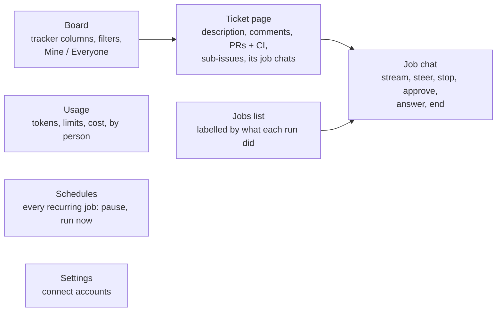
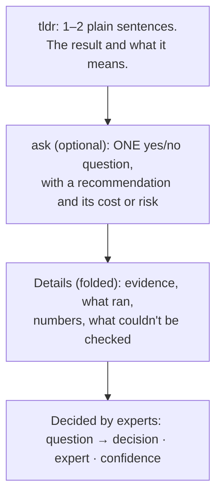
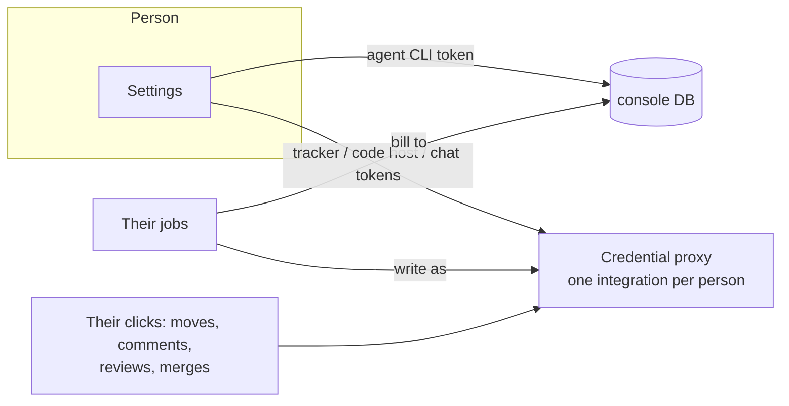

# 8. The human side

The console is where people watch, steer and decide. Agents do the work. The UI's job is to make the few moments
a person is needed fast and obvious.

## Why

- **Steerable beats observable.** A batch job you can only read afterwards wastes the moments where one sentence
  from you ("it's the other endpoint") saves an hour. Every job is a live chat.
- **People read the top and stop.** Reports, comments and chat replies lead with the answer in plain words and
  ask for at most one decision.
- **Some days you orchestrate, some days you watch.** On some days twenty jobs run and you only see outcomes.
  On others you sit on one job and watch every step. The UI supports both: a board for the first, a dense chat for
  the second.

## Screens

| Screen | What matters |
|---|---|
| **Board** | Your tracker's columns, served from the API (search and filters run server side). Snooze hides a ticket until a time. |
| **Ticket page** | Comments with agent comments colored by speaker and linked to their job. PRs with CI and deploy status, review and merge. A comment box whose send menu can also message the ticket's live agent or start Triage/Lab. |
| **Job chat** | See below. |
| **Jobs list** | One row per run, labelled by what it *did* ("opened PR", "asked a question"), not by the column it set. |
| **Usage** | Tokens per job, subscription limit windows per account, sandbox cost, per person. The billing proof (`apiKeySource`) per job. |
| **Schedules** | Every recurring job with cadence, last result and next run. Pause, resume and run now. |
| **Settings** | Each person connects their own accounts. See [More than one person](#more-than-one-person). |

## The job chat

Contract for what a person can do to a job:

| Action | Allowed in | Effect |
|---|---|---|
| **Send** a message | running, waiting_input, and terminal or parked jobs with a session | Mid-run: delivered into the stream. Idle: starts the next turn. Ended: resumes the session (parked: on a fresh sandbox) |
| **Stop** | running | Interrupts the current turn; the job goes to waiting_input. "Continue" is just the next message |
| **Approve / Deny** | a pending permission request | Answers the runtime's permission callback |
| **Answer** | a pending question from the agent | A form built from the question's options |
| **End** | any live job | If the job already reported an outcome (a follow-up run), the agent is first asked for a short "what changed since the outcome" note, which is posted to the ticket unless it replies `NOTHING`. Ending a job with no outcome sends the ticket to Needs Human |

Making a long transcript readable:

- **Step summaries.** A small, cheap model turns each run of tool calls (up to ~8 calls between the agent's messages)
  into one or two plain sentences. The chat shows the summary and expands it to the calls. Only generate these for
  jobs someone opens.
- **Fold noisy output.** Long scripts (stack start, snapshot load) fold into one line with duration and line count.
- **Header:** work time (provisioning + running across all turns), job kind, the repos touched, and a "waiting on
  you · 12m" line when it's your turn.
- **"What's running?"** The runtime reports that a tool is running, not its output. A peek button runs `ps` in the
  sandbox and shows the process tree under the tool call.
- **Screenshots** show as thumbnails under the tool call that took them.

## Writing for a tired person

This rule goes in every prompt (see [`prompts/common.md`](../prompts/common.md)) and the console's comment format
enforces it:

Good tldr: *"The spot check passed: the new flags changed nothing on the one document I tried."*
Bad tldr: *"Ran `scripts/check.sh --flags=a,b` against doc 4821; diff empty (see below)."*

Good ask: *"Can I run the same check with the flags off (about $0.50) to compare? I recommend yes."*
If an agent has several questions, it asks the one that unblocks it and holds the rest.

Before reporting, every agent re-reads its draft as a skeptical reviewer. Every "I didn't check X" that is within
reach gets checked. Every claim needs evidence (file:line, a query, a link). Every question left must be one an
expert said to escalate.

## Comments name their speaker

The console usually writes to the tracker as one account (or as the job's owner). Without a marker, every comment
looks like a person wrote it. So every console-written comment ends with a signature line:

- `— Agent Console · <kind> job [<id>](<link>)` for the console's own bookkeeping
- `— Triage agent · job [...]`, `— Lab agent · job [...]`, `— Review agent · ...` for an agent's own words

The UI strips the line, renders the comment with an agent author and a job link, and colors it by speaker. Agents
reading a ticket see `<name> (an agent, not a person)`.

When a ticket is Done and all its PRs are merged, a model writes a short **Problem / Fix** comment in plain words for
people who don't read code.

## More than one person

- **Every job has an owner:** whoever started it in the UI, whoever moved the ticket (read from the tracker's
  history when the move happened outside the console), or the epic/umbrella parent's owner.
- **The owner pays and the owner signs.** The job runs on the owner's agent subscription token. Their tracker
  moves and comments, PR reviews and merges go out under their own accounts. Limits are shown per account.
- **The setup gate.** A teammate who hasn't connected everything sees only a setup page with step-by-step
  instructions (and a prompt they can hand to their own agent to help). The API refuses everything else for them, and
  their tracker-started jobs wait in the queue with a note instead of failing or running on someone else's plan.
- **Admins** fall back to the console's own credentials until they connect their own. Ownerless work (a webhook from
  an unknown mover) runs on the console's setup.

**What I used:** the sandbox provider's login proxy put a verified email header on every request, so the console
needed no auth code of its own: an allowlist of emails, plus an admin list.

## Acceptance checks

- A message sent while the agent is mid-tool changes what it does next.
- Stop, then "continue", resumes the same session with nothing lost.
- A permission request shows in the UI within a second, and approving it unblocks the run.
- A follow-up run's End posts a "Follow-up after the outcome" comment, and the ticket stays where the outcome put it.
- A teammate with no connections can't start or see jobs, and their tracker-started job waits in `queued`.
- Every comment the console writes has a signature line, and the UI shows it as an agent comment.
