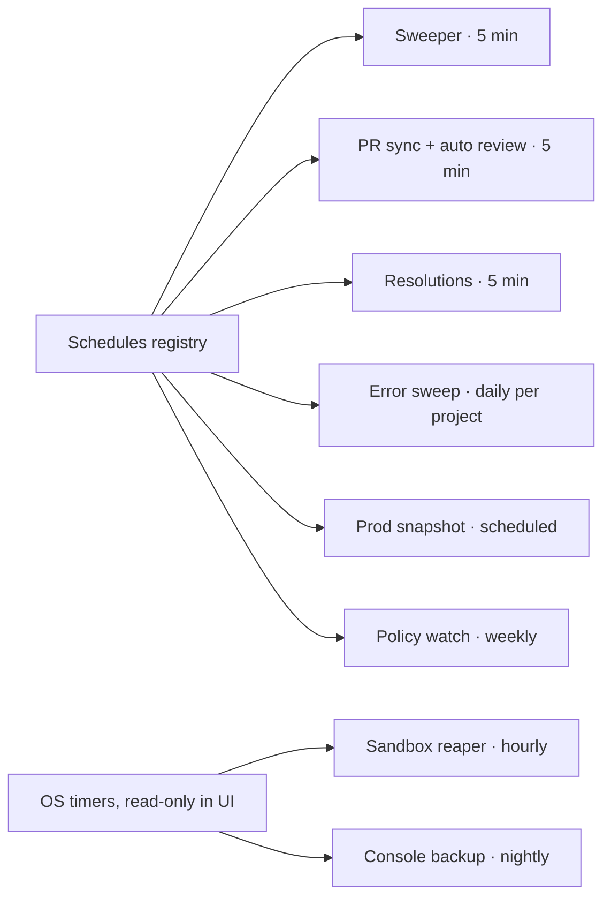
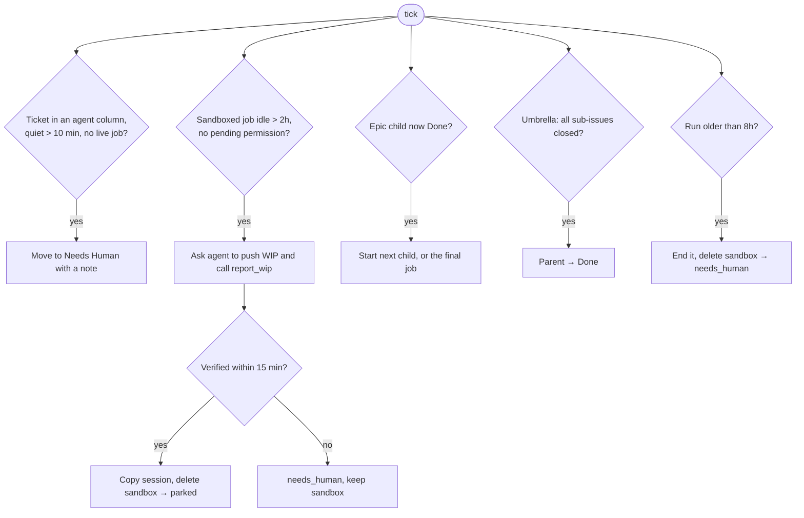

# 9. Scheduled work

Some work starts on a timer, not a ticket move. All of it goes through one registry so you can see it, pause it
and run it on demand.

## Why

- **The console keeps the books.** Stuck tickets, idle sandboxes, time caps and epic advancement are rules, so code
  enforces them on a tick. No agent is asked to remember.
- **Replace scattered automations.** Several separate scheduled agent routines (error triage, PR review
  assignment) were folded into the console as job kinds, so they get the same sandbox, tools, outcomes and chat as
  everything else.
- **One place to look.** When something didn't happen, the Schedules page says when it last ran, what it returned,
  and whether it's paused.

## The registry

**Contract.**

- Every recurring job registers with `{id, cadence, describe, tick()}`. The registry records the last run (time,
  trigger, result or error) and the next run.
- `POST /schedules/:id/paused {paused}` pauses or resumes. It's stored in settings so it survives restarts.
- `POST /schedules/:id/run` runs the job's own tick once now. The tick's own rules still apply ("once a day", "only
  when due"), so it may return "nothing to do". A run never overlaps one already in progress.
- A job turned off by config is listed with the reason and can't be run.
- The page also shows what each job does in plain words and the prompts it uses.

## Sweeper (every 5 minutes)

A long job you're chatting with isn't "stuck". The stuck rule only fires when **no job** is live for the ticket.

## PR sync and auto review

- Every 5 minutes, list open PRs across your repos. A PR names its ticket by ID (in its branch, title or body)
  or is attached to one in the tracker.
- A person's PR with no ticket gets one (To Review, or In Progress for a draft), so every change is on the board.
  Bot PRs are listed without one.
- **Intake review:** a non-draft PR opened by someone other than the console's primary user (say, a designer or a
  teammate new to the codebase) gets one `review` job, once, after it has a ticket. The review merges the base in, makes
  CI green, reviews adversarially, fixes Critical/High issues, and leads its comment with a plain-language summary.
  This means a non-engineer's PR arrives ready to review, not as a list of things they can't act on.
- Each PR gets one automatic review ever. A manual "AI Review" button can start more.

## Error-tracker sweep

Once a day per project, a ticketless `error-sweep` job (no app stack, can't edit files):

1. Lists unresolved production issues over the last 14 days, ranked by events.
2. Drops anything assigned to a person, with a fix in flight (an open PR, or one merged in the last 3 days),
   not a code bug (extension noise, network drops, third-party outages, correct 4xx), or already fixed on main.
   "Already fixed" needs all three: the raising code was changed by a traced commit, merged at least 48h ago, and no
   events since. Only then does it resolve the issue, with the commit as the reason.
3. Reads the top 3 survivors in depth and files a ticket for each: link, counts, what happens, where it fails
   (file:line on main), suspected cause and confidence, and "fix the cause, not the symptom".
4. Each filed ticket gets a Triage job straight away. From there it's an ordinary ticket.

One ticket per error-tracker issue, ever. That's tracked in the console DB.

## Policy watch (weekly)

Fetch each watched page (the provider's terms for using the agent SDK with a subscription, and its legal and compliance
page), reduce it to text and hash it. A changed hash shows a banner until someone acknowledges it. See
[Security and billing](10-security-and-billing.md) for why.

## Sandbox reaper and backups

These are OS timers on the console host. The UI shows them read-only, since changing them needs root.

- **Reaper (hourly):** deletes sandboxes tagged `ephemeral` past their age limit, skipping any tagged `keep`. It's
  the safety net for crashes; the console normally deletes its own.
- **Backup (nightly):** the console DB (using SQLite's online backup), its env file and the saved sessions go to
  object storage, using keyless workload identity rather than a stored key.

## Acceptance checks

- Pausing a schedule survives a console restart.
- "Run now" on a once-a-day job that already ran today returns "nothing to do" and doesn't start a job.
- A ticket left in Agent Queue with no job for 10 minutes reaches Needs Human with a comment, and a ticket with a
  live, chatty 3h job does not.
- An error-tracker issue that already has a ticket is never filed again.
- A sandbox tagged `keep` survives the reaper.
