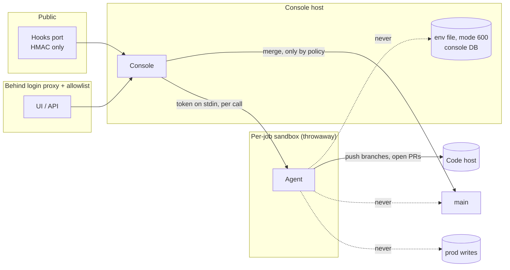
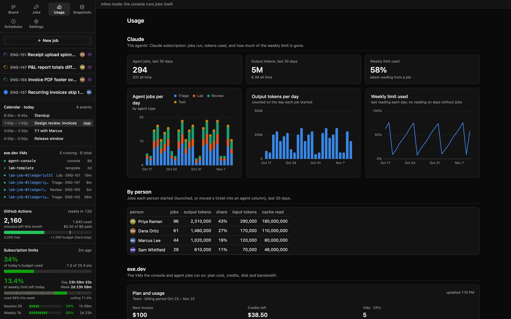
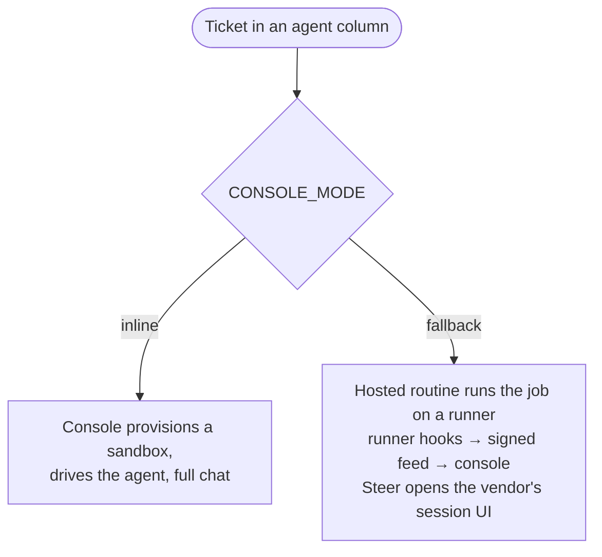

# 10. Security and billing

The console controls agents that push code and read your team's context. Treat it like CI with a chat window: a
privileged system whose blast radius you design on purpose.

## Threat model in one table

| Asset | Threat | Control |
|---|---|---|
| The console and its secrets | An agent (prompt-injected by a ticket, comment or web page) reaching them | Agents never run on the console host. Each job runs in its own sandbox. Job processes never inherit the console's secrets |
| Production data | An agent writing to or deleting it | No prod credentials anywhere an agent runs. Prod data reaches agents only through console tools (scrubbed snapshots, capped document copies, read-only queries), and every such call waits for a person |
| Production reads | Nobody knowing what was read, or why | An append-only Production access log: what ran, the agent's reason, who approved it, what came back |
| Main branch | An agent merging bad code | Agents can't merge. They open PRs. Only the console merges, and only when a policy in code allows it: auto-merge on for that repo, risk within its limit, every reviewer passed, no reserved path, under the daily cap |
| Production, through a merge | A bad auto-merge deploying | Auto-merge is off until a person turns it on per repo. The console watches the deploy, and a red one turns that repo's auto-merge back off |
| The UI | Anyone on the internet | A login proxy in front, plus an email allowlist. The UI port is never public |
| Webhooks | Forged events starting jobs | One public port serving only signed hooks (HMAC over the raw body, 1 MiB cap). Everything else returns 404 |
| People's credentials | Leaking from sandboxes, or one person acting as another | Tokens go to sandboxes per call over stdin and are never written to disk. Third-party tokens sit behind a credential proxy, and the console holds only the proxy URL. Each job writes as its owner |
| Customer data | Ending up in PRs or screenshots | Screenshots go to the (private) tracker, never into PRs. Agents are told never to paste personal data from snapshots |
| Your subscription | Many parallel jobs exhausting it | A concurrency cap, a usage display, and limits per account |

## Guardrails (in prompts and enforced where possible)

| Agents never... | Instead they... | Enforced by |
|---|---|---|
| merge | open a PR and report `to_review` | Code host branch protection; no merge rights for the sandbox's identity. The console's own identity merges, under the approver's policy |
| grade their own work | let reviewer subagents report verdicts, and the console read CI | `report_review` comes only from reviewers; the gate reads CI itself |
| write production data | write the analysis and a draft migration for a person | No credentials; prompt |
| read production without a person saying yes | ask through a prod tool, with a reason | Prod tools are never auto-approved; the approver is recorded |
| run paid or expensive jobs (benchmarks, bulk model calls) | stop and ask | Prompt; disallowed tools where you can name them |
| change auth, permissions or billing without a person | rate the risk high and add the security reviewer | Intake rules; reserved paths keep those changes out of auto-merge; expert escalation rules |
| keep going after 3 failed fix attempts | stop and summarize what they tried | Console counts attempts |
| say "done" without proof | attach tests and before/after; CI is read on the latest commit | The gate; reviewers |
| put tickets into agent columns | file in Backlog | Tool refuses |
| run full test suites in the sandbox | push early and let CI run them | Blocked commands in the template's settings |
| read DMs | read channels the owner can see | Tool scope |

The template's agent settings pre-allow the tools jobs need and deny dangerous commands. Anything else still asks
in the UI, because jobs run in the runtime's normal permission mode.

## Known weak points (design tradeoffs to decide on)

Be honest about these in your own version:

- **The console's key to the sandbox provider can probably manage every sandbox on the account.** Anyone with a
  shell on the console host can too. Keep that host's access small.
- **Any process on the console host can use the credential proxies attached to it.** That's another reason agents never
  run there.
- **Teammates' agent tokens sit in the console DB.** Encrypt at rest if your threat model needs it, and back up
  with the same care.
- **Branch pushes from sandboxes may go through one shared bot identity**, even when tracker writes go out as
  the owner.
- **The console's code-host identity can merge to main.** It needs to, for auto-merge. Keep the policy in code, not
  in a prompt; keep the reserved paths broad; and keep the global switch where an admin can reach it fast.
- **The webhook trusts the relay's view of "who moved it".** The console re-reads the tracker's history to
  attribute ownership, rather than trusting the payload.

## Billing: what I did, and the hedge

Usage: every job records how it was billed, and limits and tokens are shown per person. Real UI, fictional data.

**What I did.** The console drives the agent CLI through the vendor's Agent SDK, logged in with a long-lived
subscription token (`claude setup-token`), so usage counts against each owner's Claude subscription rather than
an API bill. Pricing was the reason.

**This may not be allowed for your use, and the terms can change.** While I was building, the provider's legal
page said Agent SDK products should use API keys, and an updated usage policy listed services that route requests
through consumer subscriptions. **Read the current terms yourself and decide.** For a team, API keys or a
team/enterprise arrangement may be the right default. Nothing in the rest of the design depends on subscription
billing.

So the design keeps three controls:

1. **Billing guard.** Refuse to start any job if an API key variable is set in the console's environment, and
   strip it from every job's env. Record the runtime's reported key source (`apiKeySource`) on every job, and
   fail the job if it isn't the expected one. That gives you proof per run of how it was billed, either way. (Flip
   the check if you choose API keys: then *require* the key.)
2. **Policy watch.** A weekly fetch of the relevant terms pages, hashed. Any change raises a banner until a
   person acknowledges it. Nothing switches automatically.
3. **Fallback mode.** One setting hands execution to the vendor's hosted agent routines on a self-hosted
   runner. The console stops provisioning and keeps a read-only feed from the runner's hooks, and Steer opens the
   session in the vendor's UI. The board, prompts, template and guardrails stay the same. Only "who starts the job"
   and "where you chat" change.

**Fallback contract.** The runner's hooks (SessionStart, PostToolUse, Stop, Notification, SessionEnd) post a signed
event `{session_id, session_url, identifier?, hook_event, tool_name?, summary, at}` to `POST /hooks/runner-event`,
with its own secret. The first event creates a read-only `routine` job. Once the routine names its ticket, any
queued inline job for that ticket becomes `superseded`, so the stuck-ticket rule sees the routine while it's live.
Message, stop and approve return 409 ("steer it in the vendor UI").

## Acceptance checks

- With an API key set in the console env, a job fails before any agent process starts, and the log says why.
- Every job row records `apiKeySource`, and an unexpected value fails the job.
- A request to the hooks port for any path but the two hooks returns 404. A bad signature returns 401.
- A UI request without an allowlisted verified-email header returns 403.
- `env` inside a running job shows no console secrets and no tracker/chat tokens.
- In fallback mode, no sandbox is ever provisioned, and a redelivered tracker event for a routine's ticket is a
  duplicate.
