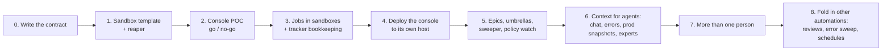

# 11. Build order

Build it in phases. Each phase is useful by itself and ends with checks that must pass before you start the next.
My first useful version took about two days, and the version these docs describe took about a week.

## Phases

### 0. Write the contract first

Before any code, write your own `CONTRACT.md`: the job record, states, outcomes → columns, the hook payload, the
tool schemas and the sweeper rules. Change the contract first, then the code, every time. It's the document your
agents will build against, and it keeps parallel agent work consistent. Docs 03–10 here are a starting point.

### 1. Sandbox template and reaper

Build one template VM with your repos, toolchain, full app stack with seed data, and headless Chrome. Script the
build so it can be redone from scratch.

- [ ] A clone boots with the stack ready, and you know how long it takes (mine: ~30s to clone, ~6 min to build the template).
- [ ] An agent in a clone can drive Chrome against the running app.
- [ ] The clone has no production write credentials.
- [ ] The reaper deletes stale `ephemeral` clones and skips `keep`.

### 2. Console POC: go / no-go

A local console that runs jobs in a temp directory, with a chat UI. These checks decide whether the approach works
at all. Run them against the real runtime, driving the console over HTTP/SSE the way the UI does.

| # | Check | Pass means |
|---|---|---|
| 1 | Two jobs in parallel | Separate chats, no crossed events |
| 2a | Steer | A message mid-run is picked up and changes what the agent does |
| 2b | Interrupt | Stops a running tool cleanly; the next message continues the session |
| 3 | Project config loads | The repo's skills, subagents, MCP servers and instruction file are active in the job |
| 4 | Billing proof | `apiKeySource` is recorded and matches what you intend; the guard refuses the wrong setup before any process starts |
| 5 | Restart | Kill the console mid-tool, restart, and the job comes back resumable; the agent remembers a code word from before |
| 6 | Remote transport | The SDK round-trips its stream over ssh to a sandbox, with no relay process needed |

Two lessons from my run: a killed console leaves its agent child running until the current tool returns, so store
the pid and stop it on startup (matching on argv so you don't kill an unrelated process). Also close unanswered
permission requests from the dead run.

**If billing fails or the terms say no,** skip to the fallback mode or use API keys. Nothing else changes.

### 3. Jobs in sandboxes, and tracker bookkeeping

- [ ] Hook → job → clone → agent → outcome → tracker comment and move → sandbox deleted, end to end on a real ticket.
- [ ] Duplicate webhook deliveries create one job.
- [ ] Idle parking: the WIP is pushed and verified, the sandbox deleted, and a message resumes on a fresh clone (mine resumed in ~15s).
- [ ] The 8h cap and the 3-attempt rule both land in Needs Human with a comment.

### 4. Deploy

The console goes on its own long-lived host: UI behind a login proxy, one public port for signed hooks only, local
jobs off, secrets in one mode-600 env file, releases as `releases/<sha>` with a `current` symlink, and an
idempotent deploy script that ships the committed HEAD.

### 5. Epics, umbrellas, sweeper, policy watch

See [Epics and umbrellas](07-epics-and-umbrellas.md) and [Scheduled work](09-scheduled-work.md).

### 6. Context for agents

Chat search and threads, error-tracker reads, scrubbed prod snapshots, and the expert subagents. This is the phase
where triage went from *"tried some things, couldn't figure it out"* to answers you can act on.

### 7. More than one person

Owners, per-person subscriptions and connections, the setup gate. See [The human side](08-humans.md).

### 8. Fold in other automations

Anything you were doing with separate scheduled agents (PR review assignment, error triage) becomes a job kind
with the same sandbox, tools and outcomes. Add the Schedules page so it all stays visible.

## Using agents to build it

I built most of this with agents, and the same rules apply:

- **Land the shared contract serially** (types, routes, schema, `CONTRACT.md`), then fan out with each agent owning
  a disjoint set of files.
- **Verify every delegated result yourself.** Read the diff, run the check. A self-report is not evidence.
- **The POC checks are your regression suite.** Keep them runnable (`pnpm check` or similar) and run them after
  any change to the manager or transport.

## What I'd do differently

| Lesson | What happened |
|---|---|
| **Start with experts and the writing rules, not add them later** | Early triage results were long, hedged, and parked on "a person must decide". Experts, the tldr/ask format and the "before you report" self-check fixed more than any model change. |
| **Put the strongest model on triage** | Triage is mostly judgment. A cheap model there makes everything downstream worse. |
| **CI is the test runner, not the sandbox** | Full suites in a sandbox were slow and hit tool timeouts. Agents now run only the tests they touched, push early as a draft PR, and watch CI. |
| **Advance epics on Done, not To Review** | Children have to build on *merged* work, or the next child starts from a branch without its predecessor. |
| **Detect umbrellas when the job starts, not when the webhook arrives** | A parent created first has no sub-issues yet when its own event arrives. |
| **Credentials out of the sandbox and off disk early** | Moving tracker, chat and code-host tokens behind a credential proxy left only the agent token and hook secrets on the console host. |
| **Sign every comment** | Once agents and the console wrote as a person's account, nobody could tell who said what. |
| **Make it multi-user from the start** | Retrofitting owners, per-person billing and the setup gate touched most of the manager. |
| **Back up from day one** | The DB is the only copy of every transcript. |
| **Keep company specifics in config and prompt overlays** | Mine ended up hardcoded in many files. If you might share yours, use one config file and base-plus-overlay prompts. |
