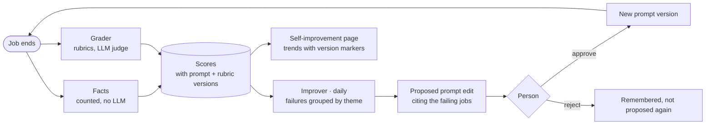

# 12. Self-improvement

The console grades its own jobs, finds the patterns in what went wrong, and proposes edits to its own prompts. A
person approves every edit, and a chart shows whether it helped.

## Why

- **Nobody watches sandboxed runs.** When a prompt is out of date, the agent rarely fails. It works around the
  problem (probes ports, retries a command five ways, guesses the environment) and reports success. All you see is
  that jobs got slower or more expensive. Grading the transcript finds what the summary hides.
- **The transcripts are already here.** Every job's full event log, tool calls, outcome, PR and ticket move live in
  the console DB. There's nothing to collect; there's only something to read.
- **Prompts are the process, so they're what to tune.** A fix to [`build.md`](../prompts/build.md) reaches every future build job. Most
  failures trace back to one missing or misleading line.
- **Memory you can't see isn't enough.** An agent that "learns overnight" changes in ways nobody can review. Here
  every change is a prompt diff a person approves, and every score is tied to the prompt version that produced it.

The idea comes from Ben Holmes's talk on self-improving agents
([video](https://www.youtube.com/watch?v=pz74r-4dGfQ)): collect transcripts, score them against rubrics, have an
agent find the patterns on a schedule, propose fixes, and chart the scores over time.

## The loop

## Two layers of scores

### Facts (every job, no LLM)

Counted when a job ends, from data the console already has. They're cheap, they can't drift, and they keep the
judge honest.

| Fact | From |
|---|---|
| **Outcome** | Reached To Review or Done, or ended in Needs Human, `failed`, the 8h cap, or no outcome |
| **Attempts** | Build: 1, 2 or 3 of 3 |
| **Rounds** | Build: red gate rounds and review rounds before passing |
| **Approver** | Build: merged or escalated, and whether a person later merged what it escalated or reverted what it merged |
| **Human cost** | Steers, questions answered, permission prompts, follow-up runs after the outcome |
| **Repeated permission prompts** | The same tool asked more than once: the template's allow/deny list needs fixing, not the prompt |
| **Tool failures** | Failed calls ÷ total, and the longest run of failures in a row |
| **Cost** | Tokens and wall time, compared within one job kind |
| **PR fate** | Filled in later: merged or closed, a person's review comments, CI red on the first push |
| **Plan accuracy** | Build: the plan approved from Plan Review as written, edited, or rejected |

**Outcome rate is the headline number.** Rubric scores explain it; they never replace it.

### Rubric grades (LLM judge)

A grader reads one job's transcript and grades it against rubric files in `prompts/graders/*.md`. Each rubric
returns pass or fail with a short reason. Each job kind has its own set.

| Rubric | Kinds | Fails when |
|---|---|---|
| **Efficiency** | all | It rediscovered the environment, retried blindly, or took a long way to an answer it could have reached directly |
| **Instruction adherence** | all | It broke a rule in its prompt or `common.md`. The reason quotes the line it missed or that misled it |
| **Unmentioned workarounds** | all | It hit a roadblock, got around it, and the outcome doesn't say so |
| **Report quality** | all | The tldr isn't plain, there's more than one ask, or it claims what it didn't verify |
| **Scope** | build | It changed things the ticket didn't ask for |
| **Test proportionality** | build | Redundant tests, or none where a test was due |
| **Verification evidence** | build, review | "Works" with no run, no failing test first, no before/after |
| **Intake** | build | What happened to the ticket afterwards says intake was wrong: the split, the risk rating, or the reviewers it picked |
| **Review quality** | build, review | A reviewer passed what a later round or a person caught, or sent back code that was fine |

Start with the first three. They produce the most actionable reasons.

Every failure carries a **blame** tag:

- **`agent`**: something the agent or its prompt got wrong. A candidate for a prompt edit.
- **`environment`**: the sandbox didn't boot, a VM vanished, a secret was missing. These go to a ticket for the
  sandbox template, **never** to a prompt edit. Without this tag, the improver tries to fix infrastructure with
  words.

### The score record

| Field | Notes |
|---|---|
| `job_id`, `kind` | |
| `prompt_versions` | copied from the job: which prompt files and versions produced this run |
| `rubric`, `rubric_version` | rubric edits change scores too, so they're versioned like prompts |
| `result` | `pass` or `fail` |
| `reason` | one or two sentences, quoting the transcript where it can |
| `blame` | `agent` or `environment`, failures only |
| `disagreed_by` | set when a person marks the grade wrong |

Facts sit beside it, one row per job.

## Prompt versions

Prompts are editable in the console's Settings, and every save is a version with an author, a note and a diff
against the repo file. Restoring an old version or going back to the repo file is a save like any other. A script
pulls saved edits back into git, so the repo stays the source of truth.

Every job stamps the versions it was built from (`prompt_versions` on the job record). That one field is what
turns a pile of scores into "this edit moved efficiency."

## The improver (daily)

A scheduled job (on the [Schedules](09-scheduled-work.md) page like everything else) that:

1. Reads the last day's failed grades with blame `agent`, grouped by prompt file and by theme.
2. Skips themes backed by too few failures. One bad run is noise.
3. Drafts an edit to the prompt file behind each remaining theme. The edit is as small as the fix: usually one
   line added or corrected.
4. Saves it as a **proposed version**, not a live one, citing the failing jobs so you can open their transcripts.
5. Checks the list of rejected proposals first and doesn't propose the same edit again.

Environment failures get one summary instead: what failed, how often, which jobs. You decide whether it's a
ticket.

The improver never edits a live prompt and never opens a PR. A person approves a proposal in the inbox, which makes
it the live version.

## The Self-improvement page

| Section | Shows |
|---|---|
| **Trends** | Per job kind: outcome rate and pass rate per rubric over time, with a marker at each prompt version. Always shows N |
| **Proposals** | Pending, approved and rejected edits, each with its diff and the jobs behind it |
| **Failure themes** | Failed grades grouped by theme, with links to the jobs |
| **Grader runs** | What was graded, how many jobs, and what it cost |
| **Judge agreement** | How often people marked a grade wrong, per rubric |

Every grade has a **disagree** button. Track how often people disagree with each rubric. If it's often, fix the
rubric before trusting its trend.

## Pitfalls

- **Small numbers.** A few jobs a day per kind is normal. Don't read a trend from four runs, and always show N.
- **Judge drift.** A rubric edit changes the scores as much as a prompt edit does. Version rubrics and chart them
  as markers too.
- **Goodhart.** Agents can learn to write reports that pass the rubric. Keep the outcome rate as the headline;
  rubrics explain it.
- **Cost.** Grading spends the same subscription as the jobs. Keep a sample rate in settings, at 100% while
  volume is low.

## Acceptance checks

- Every job records the prompt versions it ran with.
- An ended job gets its facts immediately and its grades within minutes; each grade stores its rubric version.
- A job that failed because its sandbox didn't boot is graded with blame `environment`, and the improver doesn't
  propose a prompt edit for it.
- The improver's proposal cites real failing jobs and opens as a diff. Approving it makes it live; rejecting it
  means the next day's run doesn't propose it again.
- The trend chart shows a marker at the version the approval created.
- Marking a grade wrong shows up in judge agreement for that rubric.

## What I used

- The grader and the improver are ordinary console jobs on the same subscription. Their prompts are
  [`prompts/grader.md`](../prompts/grader.md), the rubrics in [`prompts/graders/`](../prompts/graders/), and
  [`prompts/improver.md`](../prompts/improver.md).
- The grader reads a compacted transcript (messages, tool calls with their results trimmed, the outcome), not the
  raw event log. One run grades all of a job's rubrics, which costs far less than one run per rubric.
- Scores, facts and proposals are tables in the console's SQLite DB. Proposals reuse the prompt-version table with
  a `proposed` status.
