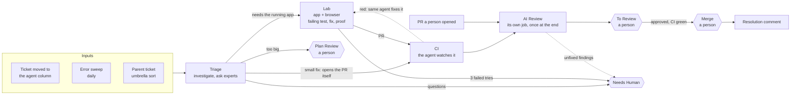
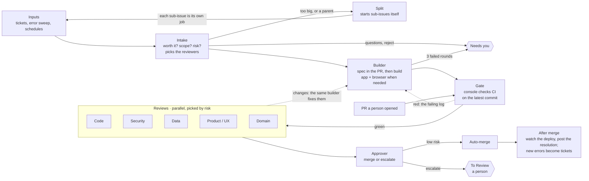

# 13. The pipeline, version 2

The pipeline in docs 3 through 9 grew one piece at a time: a triage job, then a Lab job, then an AI review job, then
a sweeper to catch what fell between them. Each piece earned its place, but the whole got harder to explain. This doc
restates it as one flow with fewer moving parts. It is a **proposal**: version 1 is what runs today, version 2 is
where it's heading.

Version 2 borrows three ideas from the software factory that [ZazenCodes](https://www.youtube.com/@ZazenCodes)
builds on video: a deterministic **gate** before any reviewer, **parallel reviewers** that send work back to the same
builder, and an **approver** that can merge without a person. Watching that design helped me hone my own process.
What stays mine is the intake, the ticket bookkeeping, the split into sub-issues and the scheduled work.

## Version 1: today

## Version 2: proposed

## What changes

| Version 1 | Version 2 | Why |
|---|---|---|
| Triage, Lab and AI Review are separate jobs on separate sandboxes | One job per ticket, with stages | The builder keeps its context through every round of fixes |
| Triage plans, Lab builds | One agent writes the spec into the PR, then builds | A spec writer and a builder hand off what one agent already knows |
| The agent watches CI and decides when it's done | The console checks CI on the PR's latest commit | A script can't skip a check or misread it |
| One review job at the end | Reviewers run after every green gate, in parallel | Problems come back while the builder still has the context |
| A person approves and merges everything | An approver merges low-risk work; a person gets the rest | People spend their time on the changes that need them |

Kept as they are: the tracker columns as switches, the outcome tool, experts before people, epics and umbrellas,
the sweeper, parking, and the scheduled work in [doc 9](09-scheduled-work.md).

## The gate

CI already runs format, lint and the test suites, and sandboxes often can't run full suites anyway. So the gate
doesn't repeat those checks. It changes **who decides they passed**: the console reads the result for the PR's latest
commit instead of trusting the agent. Red hands the builder the failing job's log. Green starts the reviews.

A quick format and lint before pushing still saves a CI round trip. That belongs in the builder's prompt, not in a
stage of its own.

## Reviews

Intake rates each ticket's risk and picks the reviewers it needs. Code review runs on every change. Security, data,
product and domain reviewers join when the change touches their area. Each is a subagent with one lens and a fresh
context, and each returns **pass** or **changes** with findings. Any **changes** sends the work back to the same
builder, then through the gate again.

Use your strongest model for reviewers. A weaker reviewer that misreads good code sends it back to the builder, and
the extra rounds cost more than the cheaper model saved.

After three rounds without passing, the job stops and asks a person.

## The approver

The approver sees the diff, the intake's risk rating, every review and the CI result, and answers **merge** or
**escalate** with a reason. The console enforces a policy the approver can only narrow, never widen:

- CI is green on the latest commit and every review passed.
- The risk rating is within the auto-merge limit you set per repo. Start with low risk only.
- The change doesn't touch paths you've reserved for people: migrations, auth and permissions, billing.
- A daily cap on auto-merges, and one switch that turns auto-merge off.

If merging to main deploys to production, auto-merge means auto-deploy. Set the limits with that in mind.

## Splitting into sub-issues

When intake finds a ticket too big for one PR, or a parent with sub-issues, it splits instead of building. The split
starts each sub-issue itself as it becomes ready, and each runs this whole pipeline as its own job on its own sandbox.

- **Umbrella:** the sub-issues are independent. They all start at once, up to the concurrency cap, each with its own
  PR to main.
- **Epic:** the sub-issues are parts of one feature. A person approves the plan, then they run one at a time on a
  feature branch, each starting after the last one merges. A final job checks the whole feature, and its PR to main
  goes through the approver like any other.
- **Nesting:** a sub-issue with its own sub-issues splits again when it reaches intake. Cap the depth so a bad split
  can't keep multiplying jobs.

Whether siblings run in parallel or in order is a property of their parent: one feature, or a bundle of unrelated
tasks. Doc [7](07-epics-and-umbrellas.md) has the details that carry over.

## Open questions

- Which repos and risk levels may auto-merge?
- Can epic sub-issues merge into the feature branch more freely, with the strict check kept for the final PR to main?
- Should a PR a person opened go to the approver, or always to a person?
