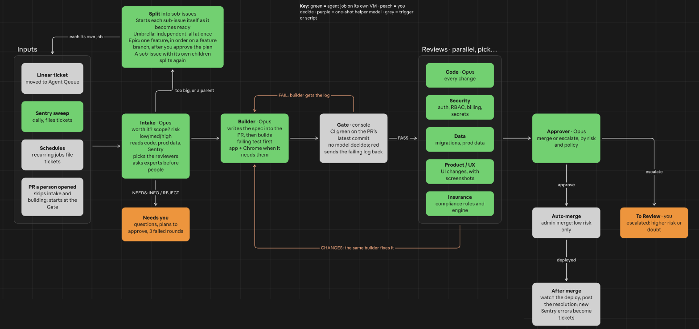

# 13. The pipeline

A ticket runs as **one build job** on its own sandbox. The job moves through stages: intake, builder, gate, reviews
and approver. Work that fails a stage goes back to the same builder, which still has its context. Work that needs a
person lands in To Review or Needs Human with one clear ask.



<sub>The design whiteboard. Green is an agent job on its own sandbox, orange is you, grey is a trigger or the console's
own code. It names the tools from my build: read Linear as the tracker, Sentry as the error tracker, and Insurance as
the domain reviewer.</sub>

The gate, the parallel reviewers and the approver come from the software factory
[ZazenCodes](https://www.youtube.com/@ZazenCodes) builds; watching it helped me hone and guide my own process.

## Why

- **One agent keeps the context.** The builder that wrote the change fixes red CI and review findings itself. Nobody
  hands off what one agent already knows.
- **Code decides what passed.** The console reads CI on the PR's latest commit. A script can't skip a check or
  misread it.
- **Problems come back early.** Reviewers run after every green gate, while the builder still has the context.
- **People spend their time where it matters.** Low-risk work in repos you trust can merge on its own. A person gets
  the rest, with every review and the approver's reason attached.

## Stages

| Stage | Who decides | Does | Leaves to |
|---|---|---|---|
| **Intake** | the agent | Is it worth doing? What's the scope? Rates risk low / medium / high and picks the reviewers. Asks experts before people | builder, a split, or Needs Human |
| **Builder** | the agent | Writes the spec into the PR, a failing test first, then the fix. Starts the app and drives a browser when the change needs it | gate (`report_outcome to_review`) |
| **Gate** | the console | Reads CI on each PR's latest commit | reviews (green) or back to the builder (red) |
| **Reviews** | reviewer subagents | One lens each, in parallel; each reports its own verdict | approver (all pass) or back to the builder |
| **Approver** | the console's policy, then a model | Merge or escalate | Done (merged) or To Review |

Every stage change is a `stage` event on the job, `{from, to, why}`, so the chat and the audit trail show where the
ticket is and how it got there.

## Intake

Intake investigates before anything else: the ticket, its comments and screenshots, linked tickets and threads, the
code end to end, and the data when the bug lives in data. Then it applies the **first** rule that matches:

1. **Unclear, or it needs a product, domain or schema decision:** ask the matching expert. If the expert says
   escalate, report `needs_human` with the question and the expert's recommendation.
2. **Not worth doing, or a duplicate:** report `needs_human` and say why.
3. **A parent with open sub-issues:** sort them (see [Splitting](#splitting)).
4. **Too big for one PR:** report `plan_review` with one sub-issue per PR.
5. **Otherwise:** rate the risk, pick the reviewers, and build.

Risky work (production data, auth and permissions, billing, paid model runs) raises the risk rating, adds the
matching reviewers, and keeps the change away from auto-merge. A change that needs a decision only a person can make
still goes to Needs Human first.

## Builder

The same agent goes on to build:

- It writes a short spec at the top of the PR: the problem, the approach, and how it proves the fix.
- It writes a failing test first, then the fix.
- It starts the app and drives a headless browser when the bug is visual or the fix needs the running app. A ticket
  queued in the second agent column (Agent Lab in my build) starts with the app already up.
- It runs a quick format and lint before pushing. That saves a CI round trip; the full suites belong to CI.
- It pushes and reports `to_review` with its PRs, the risk rating and the reviewers it wants. The run stays up, the
  turn ends, and the gate takes over.

A builder that can't make the fix work reports `attempt_failed` and starts a fresh attempt. After three, the ticket
goes to Needs Human with every attempt summarized.

## The gate

CI already runs format, lint and the test suites. The gate doesn't repeat them. It decides **who says they passed**:
the console, not a model.

- The console polls CI on each PR's latest commit. A new commit re-arms it.
- **Red:** it hands the builder the failing jobs' log tails and the job goes back to stage `build`. The builder fixes,
  pushes, and the gate runs again.
- **Green:** reviews start.
- **Stops:** 5 red rounds, CI not finished within 90 minutes, or a PR merged or closed under it. Each sends the ticket
  to Needs Human with a comment saying which.

## Reviews

Each reviewer is a subagent with one lens and a fresh context. They run in parallel inside the builder's job, and
each calls `report_review` with its own verdict. The builder can't report a verdict for them.

| Lens | Runs when |
|---|---|
| **Code** | every change |
| **Security** | auth, permissions, billing, secrets |
| **Data** | migrations, production data |
| **Product / UX** | UI changes, with screenshots |
| **Domain** | the rules your business depends on |

The lenses are code, plus the ones intake picked, plus any the changed paths call for. A finding has a severity:
`blocker`, `should_fix` or `nit`. A verdict is **changes** exactly when a finding is `blocker` or `should_fix`.

- **All pass:** the approver runs.
- **Any changes:** the findings go back to the same builder, then through the gate again.
- **A lens that didn't report** gets one nudge, then the ticket goes to Needs Human.
- **3 rounds** without passing: Needs Human, with the findings.

Use your strongest model for reviewers. A weaker reviewer that misreads good code sends it back to the builder, and
the extra rounds cost more than the cheaper model saved.

## The approver

The approver has two parts, in this order:

1. **A policy in code.** Every rule must hold, or the answer is escalate:
   - auto-merge is switched on globally, and on for every PR's repo
   - the risk rating is within that repo's limit
   - CI is green on the latest commit, and no PR is a draft
   - every lens passed
   - no changed file is under a reserved path
   - today's auto-merges are under the daily cap
2. **A model.** It sees the diff, the risk rating, every review and the CI result, and answers
   `{decision: merge | escalate, reason}`. An answer it can't read is escalate.

The model can only narrow the policy, never widen it. Merge happens only when both say yes.

- **Merge:** the console merges each PR at the commit the gate checked, and moves the ticket to Done.
- **Escalate:** the console comments on each PR with the approver's view and the policy reasons, and moves the ticket
  to To Review. A person reviews and merges.

**A merge to main deploys, so auto-merge is auto-deploy.** Auto-merge is opt-in per repo and starts off. With it off,
the approver still runs: every ticket lands in To Review with its recommendation, which is how you learn whether to
trust it.

## After merge

After an auto-merge the console watches the deploy checks on the merge commit for two hours. A red deploy sends the
ticket to Needs Human and turns that repo's auto-merge back off. A person turns it on again.

When the ticket is Done, a model posts a short Problem / Fix comment in plain words (see
[Scheduled work](09-scheduled-work.md)). New errors the deploy causes reach the daily error sweep and become tickets.

## Splitting

When intake finds a parent, or a ticket too big for one PR, it splits instead of building. Each sub-issue runs this
whole pipeline as its own build job on its own sandbox. The console starts each one as it becomes ready.

- **Umbrella:** the sub-issues are independent. Intake sorts each one to an agent or a person, and the agent ones all
  start at once, up to the concurrency cap, each with its own PR to main.
- **Epic:** the sub-issues are parts of one feature. A person approves the plan, then they run one at a time, in
  order, on a feature branch, each starting after the last one merges. A final job checks the whole feature with the
  app up, and its PR to main goes through the gate, the reviews and the approver like any other.
- **Nesting:** a sub-issue with its own sub-issues splits again when it reaches intake. A depth cap stops a bad split
  from multiplying jobs.

Whether siblings run in parallel or in order is a property of their parent: one feature, or a bundle of unrelated
tasks. [Epics and umbrellas](07-epics-and-umbrellas.md) has the contract.

## PRs a person opened

A PR a person opened skips intake and the builder. Once its CI is green on the latest commit, it gets the same
reviewers in a `review` job, and one comment with their findings, led by a plain-language summary. The ticket goes to
To Review, or Needs Human if a finding needs an answer first. The job doesn't push to someone else's PR. See
[Scheduled work](09-scheduled-work.md#pr-sync-and-intake-review).

## Settings to choose

These are yours to set. Mine are in the right column.

| Setting | Choose | Mine |
|---|---|---|
| **Auto-merge switch** | one global switch that turns every auto-merge off | off until the approver has a record I agree with |
| **Repos that may auto-merge** | per repo: off, or on | off for every repo to start |
| **Risk limit per repo** | the highest risk that may auto-merge there | low |
| **Daily cap** | auto-merges per day across all repos | 3 |
| **Reserved paths** | paths that always go to a person | migrations, CI config, auth and permissions, billing, deploy and infrastructure |
| **Gate** | red rounds, and how long CI may run | 5 rounds, 90 minutes |
| **Review rounds** | rounds of changes before a person | 3 |
| **Fix attempts** | fresh attempts before a person | 3 |
| **Split depth** | how many levels a split may nest | 2 |
| **Epic children** | whether the approver may merge them into the feature branch, or a person merges each | a person merges each; the final PR to main goes through the approver |
| **Person-opened PRs** | reviewers only, or reviewers and the approver | reviewers only; a person merges |
| **Deploy watch** | how long to watch after an auto-merge, and which checks count | 2 hours on the deploy checks |

Only admins change these, on a settings page.

## Contract

```ts
report_review({
  lens: 'code' | 'security' | 'data' | 'product' | 'domain',
  verdict: 'pass' | 'changes',
  summary: string,
  findings: { severity: 'blocker' | 'should_fix' | 'nit', where: string, what: string }[],
})
```

- Refused outside stage `review`. Stored on the job and as a `review` event.
- The console sets `verdict = changes` exactly when a finding is `blocker` or `should_fix`, whatever the reviewer
  wrote.

The job record carries `stage` (`intake` | `build` | `gate` | `review` | `approve`), `rounds` (`{gate, review}`) and
`gate` (the PRs and their commits, the lenses, the reviews, and the deploy watch). See [Jobs](04-jobs.md).

## Acceptance checks

- A build job that reports `to_review` moves to stage `gate` and stays running.
- Red CI on the latest commit hands the builder the failing log. A new push re-arms the gate. Five reds end in
  Needs Human.
- Green CI starts reviews with the code lens plus intake's picks. A lens that never reports gets one nudge, then
  Needs Human.
- A reviewer's `should_fix` finding sends the work back to the builder, then through the gate again. Three rounds end
  in Needs Human with the findings.
- With auto-merge off, a ticket that passes every review lands in To Review with the approver's comment on its PR.
- With auto-merge on for a repo, a low-risk change outside reserved paths merges and the ticket goes to Done. A change
  that touches a reserved path escalates even when the model says merge.
- The fourth auto-merge of a day with a cap of 3 escalates.
- A red deploy after an auto-merge sends the ticket to Needs Human and turns that repo's auto-merge off.
- `report_review` called during stage `build` is refused.
