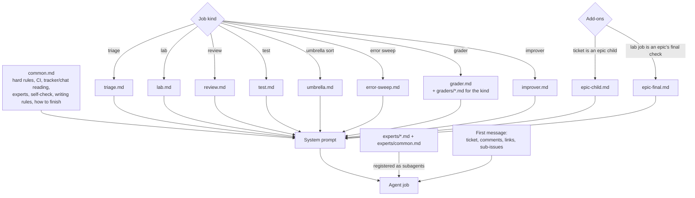

# Prompts

These are the system prompts my console gives its agents, rewritten as templates. They hold most of the value in
this repo, because each one is the process for its job kind written down. Change them to fit your own process.

## How a job's prompt is built

The console builds each job's system prompt from parts. It never asks the agent to pick its own rules.

Order: `common.md`, then the kind's file, then any add-ons, then one generated line listing the repos the
sandbox can reach. The first **user** message carries the ticket: title, description, comments with authors (agent
comments marked "(an agent, not a person)"), parent and sub-issues, and for an umbrella the sub-issues to sort.

The experts are not part of the system prompt. Each `experts/<name>.md` (its own section followed by
`experts/common.md`) is registered with the agent runtime as a named subagent, and the job calls it through its
normal subagent tool.

## Frontmatter

| Field | Meaning |
|---|---|
| `name` | Job kind or expert name |
| `description` | One line; for experts this is what the calling agent reads to choose one, so write it as "ask it before…" |
| `model` | Model for this kind; omit to use the runtime default. I use the strongest model for triage and experts, because that's where judgment lives |
| `disallowedTools` | Tools removed for this kind, e.g. no file edits for a read-only sort, no browser for review |
| `tools` | Experts only: an allowlist. Experts are read-only |

## Placeholders

Fill these in from your config when the prompt is built, or replace them once by hand.

| Placeholder | Example |
|---|---|
| `{{owner}}` | The person the job acts for (whoever moved the ticket) |
| `{{admin}}` | The person who owns the console and approves anything paid or risky |
| `{{org}}` | Your code-host org |
| `{{repos}}` | The repos checked out in the sandbox, with their paths |
| `{{product}}` | One sentence on what your product is and who uses it |
| `{{base_branch}}` | An epic's feature branch, e.g. `feature/ENG-123` |
| `{{app_urls}}` | Where the app runs inside the sandbox, e.g. API `:8080`, frontend `:3000` |
| `{{test_login}}` | Where a throwaway login for the sandbox's local app lives |
| `{{quick_checks}}` | Your fast per-repo checks (fmt, vet, lint, typecheck) |
| `{{targeted_test}}` | How to run a single named test |
| `{{risky}}` | What your team counts as risky: prod data migrations, auth, billing, paid model runs… |
| `{{min_failures}}` | Improver: how many failures a theme needs before it's worth a prompt edit, e.g. 3 |

## The tools these prompts mention

All are served by the console itself as an MCP server named `console`. See
[docs/06](../docs/06-agent-tools-and-prompts.md) for the full contract.

`report_outcome`, `report_wip`, `attach_screenshots`, `tracker_issue`, `tracker_file`, `create_ticket`,
`update_ticket`, `chat_search`, `chat_thread`, `errors_list`, `error_issue`, `error_resolve`, `file_error_ticket`,
`start_app`, `load_snapshot`, `fetch_prod_documents`, `prod_query`, `propose_prompt_edit`.

`load_snapshot`, `fetch_prod_documents` and `prod_query` reach production, so each call waits for a person's approval.

## Graders

`grader.md` is the frame and output format. Each file in `graders/` is one rubric with a `kinds` list in its
frontmatter, and the console gives the grader the rubrics for the finished job's kind. Rubrics are versioned like
prompts, because editing one changes the scores. See [docs/12](../docs/12-self-improvement.md).
